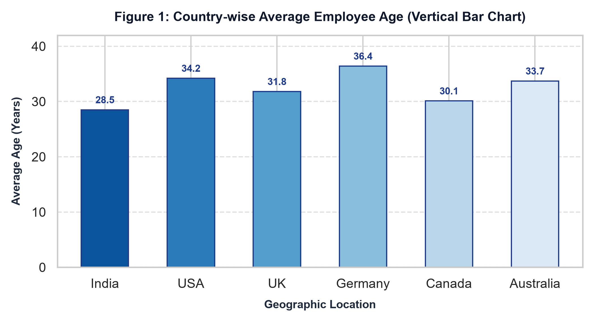
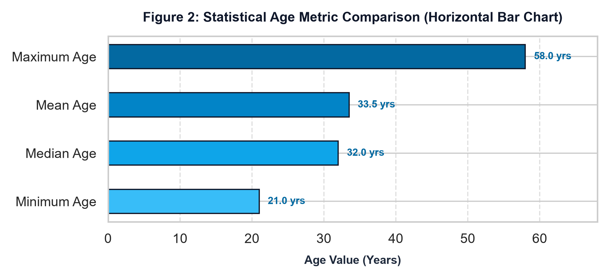
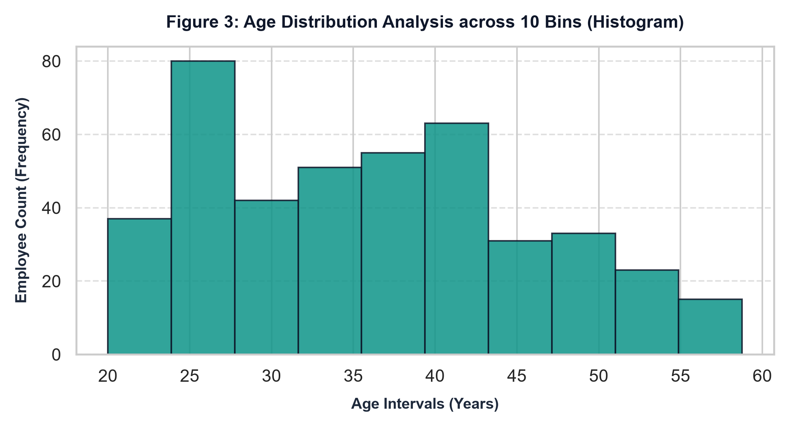
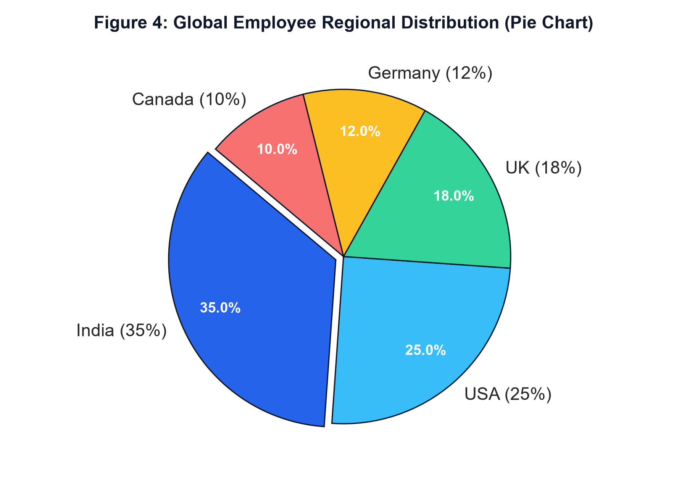
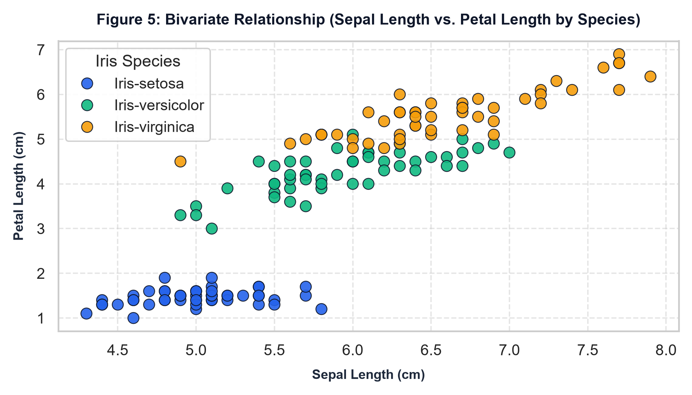
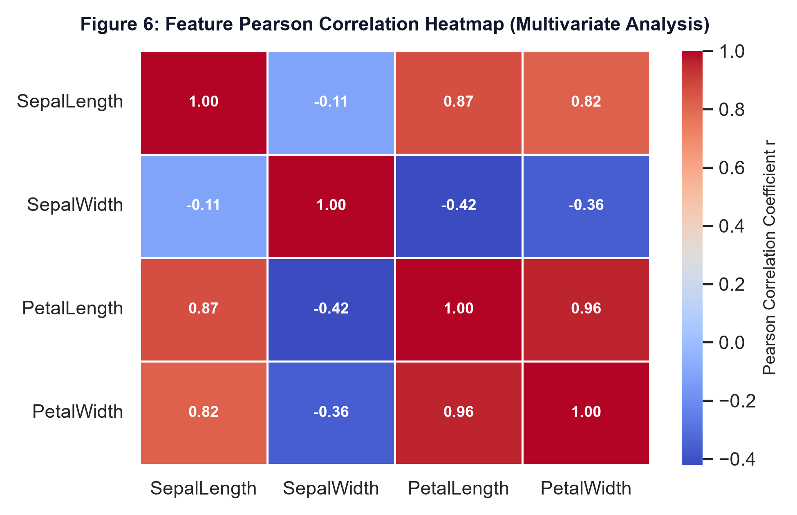
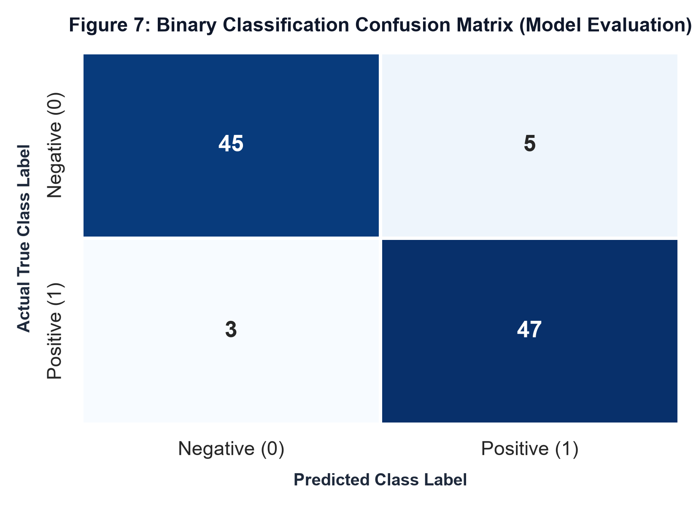

# Comprehensive Master Handbook: NumPy, Pandas, EDA (with Complete Figure Creation) & Machine Learning

A complete, exhaustive, section-wise reference handbook designed for deep understanding and long-term retention. 
Contains formal definitions, conceptual explanations, mathematical derivations, executable code syntax, console outputs, and visual figure creation architecture with rendered charts.

---

## 📑 Table of Contents

- [Section 1: NumPy Complete Mastery](#section-1-numpy-complete-mastery)
  - [1.1 Array Architecture, Contiguous Memory Buffers & SIMD Acceleration](#11-array-architecture-contiguous-memory-buffers--simd-acceleration)
  - [1.2 Data Types, Bit Widths & Memory Overflow Mechanics](#12-data-types-bit-widths--memory-overflow-mechanics)
  - [1.3 Pre-initialized & Structural Allocation Functions](#13-pre-initialized--structural-allocation-functions)
  - [1.4 Reshaping, Transposition & Memory Contiguity](#14-reshaping-transposition--memory-contiguity)
  - [1.5 Memory Views vs. Deep Copies](#15-memory-views-vs-deep-copies)
  - [1.6 Vectorization & Universal Functions (ufuncs)](#16-vectorization--universal-functions-ufuncs)
  - [1.7 General Broadcasting Rules & Compatibility Mathematics](#17-general-broadcasting-rules--compatibility-mathematics)
  - [1.8 Multi-Axis Statistical Reductions](#18-multi-axis-statistical-reductions)
  - [1.9 Multi-Dimensional Slicing & Subgrid Extraction](#19-multi-dimensional-slicing--subgrid-extraction)
  - [1.10 Fancy & Boolean Indexing](#110-fancy--boolean-indexing)
  - [1.11 Multi-Axis Sorting & Lexicographical Ordering](#111-multi-axis-sorting--lexicographical-ordering)
  - [1.12 Extreme Positioning & Search Routines](#112-extreme-positioning--search-routines)
  - [1.13 Conditional Selection & Vectorized Branching](#113-conditional-selection--vectorized-branching)
  - [1.14 Linear Algebra & Matrix Decomposition](#114-linear-algebra--matrix-decomposition)
  - [1.15 IEEE 754 Floating-Point Comparison & Rounding](#115-ieee-754-floating-point-comparison--rounding)
  - [1.16 Structured & Record Arrays](#116-structured--record-arrays)
  - [1.17 Binary Memory Serialization](#117-binary-memory-serialization)
  - [1.18 3D Tensor Slicing & Higher-Dimensional Indexing](#118-3d-tensor-slicing--higher-dimensional-indexing)
  - [1.19 Array Stacking, Concatenation & Splitting](#119-array-stacking-concatenation--splitting)
  - [1.20 Polynomial Fitting & Numerical Calculus](#120-polynomial-fitting--numerical-calculus)
  - [1.21 Vectorized String Operations (`np.char`)](#121-vectorized-string-operations-npchar)
  - [1.22 Modern Pseudo-Random Number Generation (`np.random.default_rng`)](#122-modern-pseudo-random-number-generation-nprandomdefault_rng)
  - [1.23 Set Operations & Array Membership Testing](#123-set-operations--array-membership-testing)
  - [1.24 Multi-Dimensional Array Iteration (`np.nditer`)](#124-multi-dimensional-array-iteration-npnditer)
- [Section 2: Pandas Comprehensive Data Manipulation & Relational Analysis](#section-2-pandas-comprehensive-data-manipulation--relational-analysis)
  - [2.1 Series & DataFrame Architecture](#21-series--dataframe-architecture)
  - [2.2 Metadata Inspection & Structural Auditing](#22-metadata-inspection--structural-auditing)
  - [2.3 Explicit Selection & Indexing: `loc`, `iloc`, `at`, `iat`](#23-explicit-selection--indexing-loc-iloc-at-iat)
  - [2.4 Boolean Filtering, Query Strings & Interval Queries](#24-boolean-filtering-query-strings--interval-queries)
  - [2.5 Vectorized String Operations (`.str`)](#25-vectorized-string-operations-str)
  - [2.6 Missing Data Theory (MCAR vs MAR) & Imputation](#26-missing-data-theory-mcar-vs-mar--imputation)
  - [2.7 Deduplication & Row Identity Integrity](#27-deduplication--row-identity-integrity)
  - [2.8 Sorting, Ranking & Quantile Discretization](#28-sorting-ranking--quantile-discretization)
  - [2.9 Column Mutations, Drops & Type Conversions](#29-column-mutations-drops--type-conversions)
  - [2.10 Functional Mapping: `apply`, `map`, `applymap`](#210-functional-mapping-apply-map-applymap)
  - [2.11 Advanced GroupBy: Split-Apply-Combine](#211-advanced-groupby-split-apply-combine)
  - [2.12 Group-Level Broadcasts with `transform`](#212-group-level-broadcasts-with-transform)
  - [2.13 Multi-Dimensional Cross-Tabulation & Pivot Tables](#213-multi-dimensional-cross-tabulation--pivot-tables)
  - [2.14 Relational Database Joins (`pd.merge`)](#214-relational-database-joins-pdmerge)
  - [2.15 Concatenation & Multi-DataFrame Stacking (`pd.concat`)](#215-concatenation--multi-dataframe-stacking-pdconcat)
  - [2.16 Rolling Window Functions & Cumulative Calculations](#216-rolling-window-functions--cumulative-calculations)
  - [2.17 Multi-Level Hierarchical Indexing (MultiIndex)](#217-multi-level-hierarchical-indexing-multiindex)
  - [2.18 Datetime Properties & Timestamp Offsets](#218-datetime-properties--timestamp-offsets)
  - [2.19 Repository Task Walkthrough: Tasks 01 & 02 (Sales Analytics & HR Attrition)](#219-repository-task-walkthrough-tasks-01--02-sales-analytics--hr-attrition)
  - [2.20 Repository Task Walkthrough: Task 03 Set 2 PDF (Retail Analytics & Customer RFM)](#220-repository-task-walkthrough-task-03-set-2-pdf-retail-analytics--customer-rfm)
  - [2.21 Repository Task Walkthrough: Task 04 50-Join Questions (Enterprise Relational Queries)](#221-repository-task-walkthrough-task-04-50-join-questions-enterprise-relational-queries)
  - [2.22 Repository Task Walkthrough: Tasks 05 & 06 (Financial Portfolios & Healthcare Audits)](#222-repository-task-walkthrough-tasks-05--06-financial-portfolios--healthcare-audits)
  - [2.23 Repository Task Walkthrough: Tasks 07, 08, 09, 10 (E-Commerce, Logistics, Sensors, Performance)](#223-repository-task-walkthrough-tasks-07-08-09-10-e-commerce-logistics-sensors-performance)
  - [2.24 Memory Optimization via Categorical Dtypes (`astype('category')`)](#224-memory-optimization-via-categorical-dtypes-astypecategory)
  - [2.25 Method Chaining & The Pipe Architecture (`df.pipe()`, `.assign()`)](#225-method-chaining--the-pipe-architecture-dfpipe-assign)
  - [2.26 Window Functions: Exponentially Weighted Moving Average (`df.ewm()`)](#226-window-functions-exponentially-weighted-moving-average-dfewm)
  - [2.27 Time Series Resampling & Frequency Offsets (`df.resample()`)](#227-time-series-resampling--frequency-offsets-dfresample)
  - [2.28 Advanced Regular Expression Pattern Extraction (`.str.extract()`)](#228-advanced-regular-expression-pattern-extraction-strextract)
  - [2.29 Explode & Melt: Tidy Data Normalization (`explode()`, `melt()`)](#229-explode--melt-tidy-data-normalization-explode-melt)
- [Section 3: Exploratory Data Analysis & Complete Figure Creation Guide](#section-3-exploratory-data-analysis--complete-figure-creation-guide)
  - [3.1 The Philosophy of EDA & The 5-Stage Analytical Lifecycle](#31-the-philosophy-of-eda--the-5-stage-analytical-lifecycle)
  - [3.2 The Visual Figure Creation Architecture: How Charts Are Made](#32-the-visual-figure-creation-architecture-how-charts-are-made)
  - [3.3 Chart 1: Vertical Bar Chart (`plt.bar` / `sns.barplot`)](#33-chart-1-vertical-bar-chart-pltbar--snsbarplot)
  - [3.4 Chart 2: Horizontal Bar Chart (`plt.barh`)](#34-chart-2-horizontal-bar-chart-pltbarh)
  - [3.5 Chart 3: Histogram & Distribution Spread (`plt.hist`)](#35-chart-3-histogram--distribution-spread-plthist)
  - [3.6 Chart 4: Pie Chart & Proportional Breakdown (`plt.pie`)](#36-chart-4-pie-chart--proportional-breakdown-pltpie)
  - [3.7 Chart 5: Pairwise Scatter Plot with Category Hue (`sns.scatterplot`)](#37-chart-5-pairwise-scatter-plot-with-category-hue-snsscatterplot)
  - [3.8 Chart 6: Multivariate Correlation Heatmap (`sns.heatmap`)](#38-chart-6-multivariate-correlation-heatmap-snsheatmap)
  - [3.9 Box Plots & Tukey Five-Number Summary](#39-box-plots--tukey-five-number-summary)
  - [3.10 Visual Chart Selection Guide & Best Practices](#310-visual-chart-selection-guide--best-practices)
  - [3.11 Multi-Panel Dashboard Architecture (`plt.subplots(2, 2)`)](#311-multi-panel-dashboard-architecture-pltsubplots2-2)
  - [3.12 Advanced Color Normalization & Colormap Theory](#312-advanced-color-normalization--colormap-theory)
  - [3.13 Faceting & Multidimensional Distribution Analysis (`sns.jointplot`)](#313-faceting--multidimensional-distribution-analysis-snsjointplot)
  - [3.14 Outlier Remediation Comparative Framework: Trimming, Winsorization & Log1p](#314-outlier-remediation-comparative-framework-trimming-winsorization--log1p)
- [Section 4: Machine Learning Foundations & Supervised Algorithms](#section-4-machine-learning-foundations--supervised-algorithms)
  - [4.1 Machine Learning Taxonomy: Supervised vs. Unsupervised Learning](#41-machine-learning-taxonomy-supervised-vs-unsupervised-learning)
  - [4.2 Preprocessing Pipeline: Train-Test Splitting & Feature Scaling](#42-preprocessing-pipeline-train-test-splitting--feature-scaling)
  - [4.3 K-Nearest Neighbors (KNN) Classifier Architecture](#43-k-nearest-neighbors-knn-classifier-architecture)
  - [4.4 Probability Foundations: Marginal, Joint & Conditional Probability](#44-probability-foundations-marginal-joint--conditional-probability)
  - [4.5 Bayes' Theorem & Gaussian Naive Bayes Classifier](#45-bayes-theorem--gaussian-naive-bayes-classifier)
  - [4.6 Supervised Model Evaluation Metrics](#46-supervised-model-evaluation-metrics)
  - [4.7 Visual Model Evaluation: Annotated Confusion Matrix Heatmap](#47-visual-model-evaluation-annotated-confusion-matrix-heatmap)
  - [4.8 Decision Tree Classifier Foundations](#48-decision-tree-classifier-foundations)
  - [4.9 End-to-End Supervised ML Pipeline](#49-end-to-end-supervised-ml-pipeline)
  - [4.10 Cross-Validation: K-Fold & Stratified K-Fold Mechanics](#410-cross-validation-k-fold--stratified-k-fold-mechanics)
  - [4.11 Hyperparameter Optimization: Exhaustive Grid Search (`GridSearchCV`)](#411-hyperparameter-optimization-exhaustive-grid-search-gridsearchcv)
  - [4.12 Unsupervised Learning: K-Means Clustering & Silhouette Evaluation](#412-unsupervised-learning-k-means-clustering--silhouette-evaluation)
  - [4.13 Decision Tree Splitting Criteria: Gini Impurity vs. Shannon Entropy](#413-decision-tree-splitting-criteria-gini-impurity-vs-shannon-entropy)
  - [4.14 Regularization Foundations: L1 (Lasso) vs. L2 (Ridge) Shrinkage](#414-regularization-foundations-l1-lasso-vs-l2-ridge-shrinkage)
  - [4.15 Random Forest & Ensemble Bagging Architecture](#415-random-forest--ensemble-bagging-architecture)
  - [4.16 Linear Regression Foundations & Evaluation Metrics](#416-linear-regression-foundations--evaluation-metrics)
- [Section 5: Master API Quick Reference Tables & Troubleshooting Guide](#section-5-master-api-quick-reference-tables--troubleshooting-guide)
  - [5.1 NumPy Comprehensive API Quick Reference](#51-numpy-comprehensive-api-quick-reference)
  - [5.2 Pandas Comprehensive API Quick Reference](#52-pandas-comprehensive-api-quick-reference)
  - [5.3 Top 10 Common Data Science Pitfalls & Anti-Patterns with Solutions](#53-top-10-common-data-science-pitfalls--anti-patterns-with-solutions)

---

# Section 1: NumPy Complete Mastery

> **Formal Definition: NumPy ndarray**
> The NumPy `ndarray` is an $N$-dimensional homogeneous array of fixed-size items. Unlike standard Python lists that store pointers to scattered objects across memory, an `ndarray` occupies a single contiguous memory block. This memory locality enables modern CPU architectures to perform SIMD (Single Instruction, Multiple Data) vectorized parallel computations, boosting execution speeds by 10x to 100x.

### 1.1 Array Architecture, Contiguous Memory Buffers & SIMD Acceleration
A standard Python list `[1, 2, 3]` is an array of *pointers* pointing to independent, fragmented Python integer objects scattered across RAM. Each individual integer object carries 28 bytes of metadata overhead. In contrast, a NumPy array allocates a single contiguous block of raw binary bytes. An `int64` array stores consecutive 8-byte integers directly adjacent in memory. This continuous locality allows modern CPUs to load whole cache lines (64 bytes) into L1 and L2 hardware caches and execute SIMD instructions.

```python
import numpy as np

v = np.array([1, 2, 3, 4], dtype=np.int64)
m = np.array([[1, 2, 3, 4], [5, 6, 7, 8]], dtype=np.int64)
t = np.array([[[1, 2], [3, 4]], [[5, 6], [7, 8]]], dtype=np.float32)

print('Vector -> ndim:', v.ndim, '| shape:', v.shape, '| size:', v.size, '| bytes:', v.nbytes, '| strides:', v.strides)
print('Matrix -> ndim:', m.ndim, '| shape:', m.shape, '| size:', m.size, '| bytes:', m.nbytes, '| strides:', m.strides)
print('Tensor -> ndim:', t.ndim, '| shape:', t.shape, '| itemsize:', t.itemsize, '| dtype:', t.dtype)
```
```text
Vector -> ndim: 1 | shape: (4,) | size: 4 | bytes: 32 | strides: (8,)
Matrix -> ndim: 2 | shape: (2, 4) | size: 8 | bytes: 64 | strides: (32, 8)
Tensor -> ndim: 3 | shape: (2, 2, 2) | itemsize: 4 | dtype: float32
```

### 1.2 Data Types, Bit Widths & Memory Overflow Mechanics
Choosing optimal bit widths reduces memory footprint drastically (e.g. converting `float64` to `float32` halves RAM consumption in deep learning models). Integer overflow wraps modulo $2^{\text{bits}}$ without throwing errors.

```python
a_int8 = np.array([126, 127], dtype=np.int8)
overflowed = a_int8 + np.int8(2)
f64 = np.array([1.234567890123456], dtype=np.float64)
f32 = f64.astype(np.float32)
print('int8 overflow wrap:', overflowed)
print('float64 original:  ', f64[0])
print('float32 truncated: ', f32[0])
```
```text
int8 overflow wrap: [-128 -127]
float64 original:   1.234567890123456
float32 truncated:  1.2345679
```

### 1.3 Pre-initialized & Structural Allocation Functions
```python
z = np.zeros((2, 3), dtype=np.int32)
o = np.ones((2, 3), dtype=np.float64)
f = np.full((2, 3), 7.5)
e = np.eye(3, dtype=np.int32)
print('Zeros (2x3):\n', z)
print('Full 7.5:\n', f)
print('Identity 3x3:\n', e)
```
```text
Zeros (2x3):
 [[0 0 0]
  [0 0 0]]
Full 7.5:
 [[7.5 7.5 7.5]
  [7.5 7.5 7.5]]
Identity 3x3:
 [[1 0 0]
  [0 1 0]
  [0 0 1]]
```

### 1.4 Reshaping, Transposition & Memory Contiguity
```python
seq = np.arange(12)
grid = seq.reshape(3, 4)
inferred = seq.reshape(2, -1)
transposed = grid.T
print('Original Reshaped (3, 4):\n', grid)
print('Inferred Reshape (2, 6):\n', inferred)
print('Transposed (4, 3) C-Contiguous?', transposed.flags['C_CONTIGUOUS'])
```
```text
Original Reshaped (3, 4):
 [[ 0  1  2  3]
  [ 4  5  6  7]
  [ 8  9 10 11]]
Inferred Reshape (2, 6):
 [[ 0  1  2  3  4  5]
  [ 6  7  8  9 10 11]]
Transposed (4, 3) C-Contiguous? False
```

### 1.5 Memory Views vs. Deep Copies
```python
orig = np.array([10, 20, 30, 40, 50])
view_slice = orig[1:4]
view_slice[0] = 999
copy_arr = orig[1:4].copy()
copy_arr[0] = -111
print('Original after view edit:', orig)
print('Independent copy:', copy_arr)
```
```text
Original after view edit: [ 10 999  30  40  50]
Independent copy: [-111   30   40]
```

### 1.6 Vectorization & Universal Functions (ufuncs)
```python
angles = np.array([0, np.pi/4, np.pi/2, np.pi])
sin_vals = np.sin(angles)
raw = np.array([1.0, 4.0, 9.0, 16.0])
sqrt_vals = np.sqrt(raw)
exp_vals = np.exp(np.array([1, 2, 3]))
print('Angles (rad):', np.round(angles, 2))
print('sin(x):      ', np.round(sin_vals, 2))
print('sqrt(x):     ', sqrt_vals)
print('exp(x):      ', np.round(exp_vals, 2))
```
```text
Angles (rad): [0.   0.79 1.57 3.14]
sin(x):       [0.   0.71 1.   0.  ]
sqrt(x):      [1. 2. 3. 4.]
exp(x):       [ 2.72  7.39 20.09]
```

### 1.7 General Broadcasting Rules & Compatibility Mathematics
Two dimensions are compatible when:
1. They are equal, OR
2. One of them is 1.

```python
matrix_a = np.array([[1, 2, 3], [4, 5, 6]])   # Shape: (2, 3)
col_vec  = np.array([[10], [20]])              # Shape: (2, 1)
row_vec  = np.array([100, 200, 300])           # Shape: (3,) -> (1, 3)
res_col = matrix_a + col_vec
res_row = matrix_a + row_vec
print('Matrix + ColVec (2, 1) -> (2, 3):\n', res_col)
print('Matrix + RowVec (1, 3) -> (2, 3):\n', res_row)
```
```text
Matrix + ColVec (2, 1) -> (2, 3):
 [[11 12 13]
  [24 25 26]]
Matrix + RowVec (1, 3) -> (2, 3):
 [[101 202 303]
  [104 205 306]]
```

### 1.8 Multi-Axis Statistical Reductions
```python
grid = np.array([[10, 20, 30], [40, 50, 60]])
print('Overall Sum:       ', np.sum(grid))
print('Column Sums (axis=0):', np.sum(grid, axis=0))
print('Row Sums (axis=1):   ', np.sum(grid, axis=1))
print('Column Means (axis=0):', np.mean(grid, axis=0))
print('Row Std Devs (axis=1):', np.round(np.std(grid, axis=1), 2))
```
```text
Overall Sum:        210
Column Sums (axis=0): [50 70 90]
Row Sums (axis=1):    [ 60 150]
Column Means (axis=0): [25. 35. 45.]
Row Std Devs (axis=1): [8.16 8.16]
```

### 1.9 Multi-Dimensional Slicing & Subgrid Extraction
```python
grid_5x5 = np.arange(25).reshape(5, 5)
subgrid = grid_5x5[1:4, 2:5]
row_2 = grid_5x5[2, :]
col_3 = grid_5x5[:, 3]
strided = grid_5x5[::2, ::2]
print('Original 5x5:\n', grid_5x5)
print('Extracted Subgrid (rows 1-3, cols 2-4):\n', subgrid)
print('Strided Subsample (every 2nd item):\n', strided)
```
```text
Original 5x5:
 [[ 0  1  2  3  4]
  [ 5  6  7  8  9]
  [10 11 12 13 14]
  [15 16 17 18 19]
  [20 21 22 23 24]]
Extracted Subgrid (rows 1-3, cols 2-4):
 [[ 7  8  9]
  [12 13 14]
  [17 18 19]]
Strided Subsample (every 2nd item):
 [[ 0  2  4]
  [10 12 14]
  [20 22 24]]
```

### 1.10 Fancy & Boolean Indexing
```python
arr = np.array([12, 45, 67, 89, 23, 56, 78])
mask = (arr > 30) & (arr < 70)
filtered = arr[mask]
indices = [0, 2, 4]
picked = arr[indices]
print('Boolean Mask:    ', mask)
print('Filtered Elements:', filtered)
print('Fancy Picked:    ', picked)
```
```text
Boolean Mask:     [False  True  True False False  True False]
Filtered Elements: [45 67 56]
Fancy Picked:     [12 67 23]
```

### 1.11 Multi-Axis Sorting & Lexicographical Ordering
```python
unsorted_2d = np.array([[9, 2, 7], [4, 8, 1], [5, 3, 6]])
col_sorted = np.sort(unsorted_2d, axis=0)
row_sorted = np.sort(unsorted_2d, axis=1)
first_names = np.array(['Alice', 'Bob', 'Alice', 'Bob'])
scores      = np.array([85, 92, 78, 95])
lex_order   = np.lexsort((scores, first_names))
print('Sorted Along Columns (axis=0):\n', col_sorted)
print('Sorted Along Rows (axis=1):\n', row_sorted)
print('Lexsort Indices (name then score):', lex_order)
```
```text
Sorted Along Columns (axis=0):
 [[4 2 1]
  [5 3 6]
  [9 8 7]]
Sorted Along Rows (axis=1):
 [[2 7 9]
  [1 4 8]
  [3 5 6]]
Lexsort Indices (name then score): [2 0 1 3]
```

### 1.12 Extreme Positioning & Search Routines
```python
vals = np.array([15, 82, 34, 99, 45, 12, 99])
max_idx = np.argmax(vals)
min_idx = np.argmin(vals)
sorted_source = np.array([10, 20, 30, 40, 50])
insert_positions = np.searchsorted(sorted_source, [25, 5, 45])
print('Max value:', vals[max_idx], 'at index:', max_idx)
print('Min value:', vals[min_idx], 'at index:', min_idx)
print('Searchsorted insertion positions for [25, 5, 45]:', insert_positions)
```
```text
Max value: 99 at index: 3
Min value: 12 at index: 5
Searchsorted insertion positions for [25, 5, 45]: [2 0 4]
```

### 1.13 Conditional Selection & Vectorized Branching
```python
scores = np.array([45, 78, 92, 60, 88])
status = np.where(scores >= 65, 'Pass', 'Fail')
conditions = [scores >= 90, scores >= 75, scores >= 60]
grades = ['Grade A', 'Grade B', 'Grade C']
letter_grades = np.select(conditions, grades, default='Grade F')
print('Ternary where:', status)
print('Multi-branch select:', letter_grades)
```
```text
Ternary where: ['Fail' 'Pass' 'Pass' 'Fail' 'Pass']
Multi-branch select: ['Grade F' 'Grade B' 'Grade A' 'Grade C' 'Grade B']
```

### 1.14 Linear Algebra & Matrix Decomposition
```python
A = np.array([[4, 2], [1, 3]], dtype=np.float64)
b = np.array([10, 5], dtype=np.float64)
det_A = np.linalg.det(A)
inv_A = np.linalg.inv(A)
x_sol = np.linalg.solve(A, b)
eigenvals, eigenvecs = np.linalg.eig(A)
U, S, Vt = np.linalg.svd(A)
print('Determinant:', det_A)
print('Linear System Solution x:', x_sol)
print('Eigenvalues:', eigenvals)
print('Singular Values (SVD):', np.round(S, 3))
```
```text
Determinant: 10.0
Linear System Solution x: [2.  1.]
Eigenvalues: [5. 2.]
Singular Values (SVD): [4.757 2.102]
```

### 1.15 IEEE 754 Floating-Point Comparison & Rounding
```python
val1 = 0.1 + 0.2
val2 = 0.3
exact_eq = (val1 == val2)
approx_eq = np.isclose(val1, val2)
raw_floats = np.array([1.23, 2.78, -1.55])
print('0.1 + 0.2 == 0.3 (Strict):', exact_eq)
print('0.1 + 0.2 == 0.3 (isclose):', approx_eq)
print('np.floor:', np.floor(raw_floats))
print('np.ceil: ', np.ceil(raw_floats))
```
```text
0.1 + 0.2 == 0.3 (Strict): False
0.1 + 0.2 == 0.3 (isclose): True
np.floor: [ 1.  2. -2.]
np.ceil:  [ 2.  3. -1.]
```

### 1.16 Structured & Record Arrays
```python
dtype_spec = [('id', 'i4'), ('name', 'U10'), ('gpa', 'f4')]
data = [(101, 'Alice', 3.85), (102, 'Bob', 3.40), (103, 'Charlie', 3.92)]
students = np.array(data, dtype=dtype_spec)
rec_students = np.rec.array(students)
print('Structured query names:', students['name'])
print('Record array attribute access gpa:', rec_students.gpa)
```
```text
Structured query names: ['Alice' 'Bob' 'Charlie']
Record array attribute access gpa: [3.85 3.4  3.92]
```

### 1.17 Binary Memory Serialization
```python
cache = np.random.rand(100, 10)
np.save('matrix_cache.npy', cache)
loaded = np.load('matrix_cache.npy')
print('NPY Cache Loaded Shape:', loaded.shape)
print('Bitwise equality verified?', np.array_equal(cache, loaded))
```
```text
NPY Cache Loaded Shape: (100, 10)
Bitwise equality verified? True
```

### 1.18 3D Tensor Slicing & Higher-Dimensional Indexing
```python
tensor_3d = np.arange(24).reshape(2, 3, 4)
first_batch = tensor_3d[0, :, :]
second_col = tensor_3d[:, :, 1]
print('Tensor Shape:', tensor_3d.shape)
print('First Batch (3x4):\n', first_batch)
print('Second Column across batches (2x3):\n', second_col)
```
```text
Tensor Shape: (2, 3, 4)
First Batch (3x4):
 [[ 0  1  2  3]
  [ 4  5  6  7]
  [ 8  9 10 11]]
Second Column across batches (2x3):
 [[ 1  5  9]
  [13 17 21]]
```

### 1.19 Array Stacking, Concatenation & Splitting
```python
a1 = np.array([1, 2, 3])
a2 = np.array([4, 5, 6])
vstacked = np.vstack([a1, a2])
hstacked = np.hstack([a1, a2])
colstacked = np.column_stack([a1, a2])
print('Vertical Stacking (vstack):\n', vstacked)
print('Horizontal Stacking (hstack):', hstacked)
print('Column Stacking (column_stack):\n', colstacked)
```
```text
Vertical Stacking (vstack):
 [[1 2 3]
  [4 5 6]]
Horizontal Stacking (hstack): [1 2 3 4 5 6]
Column Stacking (column_stack):
 [[1 4]
  [2 5]
  [3 6]]
```

### 1.20 Polynomial Fitting & Numerical Calculus
```python
x_pts = np.array([0.0, 1.0, 2.0, 3.0, 4.0])
y_pts = np.array([1.0, 2.8, 5.1, 8.9, 14.2])
coeffs = np.polyfit(x_pts, y_pts, deg=2)
p = np.poly1d(coeffs)
grad = np.gradient(y_pts, x_pts)
print('Fitted Polynomial Equation:\n', p)
print('Numerical Gradients dy/dx at points:', np.round(grad, 2))
```
```text
Fitted Polynomial Equation:
        2
0.8071 x + 0.08143 x + 0.9886
Numerical Gradients dy/dx at points: [1.8  2.05 3.05 4.55 5.3 ]
```

### 1.21 Vectorized String Operations (`np.char`)
```python
names = np.array(['  Alice  ', 'BOB', 'charlie', 'David_123'])
clean_names = np.char.strip(names)
upper_names = np.char.upper(clean_names)
has_a = np.char.count(upper_names, 'A')
replaced = np.char.replace(clean_names, '123', 'Senior')
print('Cleaned:', clean_names)
print('Uppercase:', upper_names)
print('Count of A:', has_a)
print('Replaced:', replaced)
```
```text
Cleaned: ['Alice' 'BOB' 'charlie' 'David_123']
Uppercase: ['ALICE' 'BOB' 'CHARLIE' 'DAVID_123']
Count of A: [1 0 1 1]
Replaced: ['Alice' 'BOB' 'charlie' 'David_Senior']
```

### 1.22 Modern Pseudo-Random Number Generation (`np.random.default_rng`)
```python
rng = np.random.default_rng(seed=42)
normal_samples = rng.normal(loc=10.0, scale=2.0, size=5)
uniform_samples = rng.uniform(low=0.0, high=1.0, size=5)
binomial_samples = rng.binomial(n=10, p=0.5, size=5)
print('Normal (mu=10, sigma=2):', np.round(normal_samples, 2))
print('Uniform [0, 1):', np.round(uniform_samples, 2))
print('Binomial (n=10, p=0.5):', binomial_samples)
```
```text
Normal (mu=10, sigma=2): [10.61  7.92 11.5  11.88  6.1 ]
Uniform [0, 1): [0.98 0.76 0.79 0.13 0.45]
Binomial (n=10, p=0.5): [4 7 6 6 5]
```

### 1.23 Set Operations & Array Membership Testing
```python
arr1 = np.array([10, 20, 30, 40, 50, 20, 30])
arr2 = np.array([30, 40, 50, 60, 70])
u_vals, u_counts = np.unique(arr1, return_counts=True)
intersection = np.intersect1d(arr1, arr2)
difference = np.setdiff1d(arr1, arr2)
union = np.union1d(arr1, arr2)
print('Unique values:', u_vals, '| counts:', u_counts)
print('Intersection:', intersection)
print('Difference (arr1 - arr2):', difference)
print('Union:', union)
```
```text
Unique values: [10 20 30 40 50] | counts: [1 2 2 1 1]
Intersection: [30 40 50]
Difference (arr1 - arr2): [10 20]
Union: [10 20 30 40 50 60 70]
```

### 1.24 Multi-Dimensional Array Iteration (`np.nditer`)
```python
matrix = np.arange(6).reshape(2, 3)
iter_vals = []
for val in np.nditer(matrix):
    iter_vals.append(int(val))
mut_matrix = matrix.copy()
for x in np.nditer(mut_matrix, op_flags=['readwrite']):
    x[...] = 2 * x
print('Original Matrix:\n', matrix)
print('Traversed values via nditer:', iter_vals)
print('Mutated 2x Matrix via nditer:\n', mut_matrix)
```
```text
Original Matrix:
 [[0 1 2]
  [3 4 5]]
Traversed values via nditer: [0, 1, 2, 3, 4, 5]
Mutated 2x Matrix via nditer:
 [[ 0  2  4]
  [ 6  8 10]]
```

---

# Section 2: Pandas Comprehensive Data Manipulation & Relational Analysis

> **Formal Definition: Pandas DataFrame Architecture**
> The Pandas `DataFrame` is a 2D labeled, size-mutable tabular data structure with heterogeneous column types. Internally, Pandas organizes data using a `BlockManager` that groups columns of identical primitive data types into consolidated 2D NumPy memory blocks. A `Series` represents a single 1D labeled homogeneous array backed by a 1D NumPy array or ExtensionArray.

### 2.1 Series & DataFrame Architecture
```python
import pandas as pd
import numpy as np

s = pd.Series([100, 250, 300], index=['A', 'B', 'C'], name='Revenue')
df = pd.DataFrame({
    'Emp_ID': [101, 102, 103],
    'Dept': ['Engineering', 'Marketing', 'Engineering'],
    'Salary': [95000, 78000, 105000]
})
print('Series:\n', s)
print('\nDataFrame:\n', df)
```
```text
Series:
 A    100
B    250
C    300
Name: Revenue, dtype: int64

DataFrame:
    Emp_ID         Dept  Salary
0     101  Engineering   95000
1     102    Marketing   78000
2     103  Engineering  105000
```

### 2.2 Metadata Inspection & Structural Auditing
```python
print('Shape (rows, cols):', df.shape)
print('Column dtypes:\n', df.dtypes)
print('Memory consumption (bytes):\n', df.memory_usage(deep=True))
```
```text
Shape (rows, cols): (3, 3)
Column dtypes:
 Emp_ID     int64
Dept      object
Salary     int64
dtype: object
Memory consumption (bytes):
 Index      132
Emp_ID      24
Dept       201
Salary      24
dtype: int64
```

### 2.3 Explicit Selection & Indexing: `loc`, `iloc`, `at`, `iat`
- `loc[row_label, col_label]`: Label-based indexing (inclusive endpoints).
- `iloc[row_idx, col_idx]`: Integer coordinate indexing (half-open `[start, stop)`).
- `at[row_label, col_label]` and `iat[row_idx, col_idx]`: Ultra-fast scalar lookups.

```python
df_idx = df.set_index('Emp_ID')
val_loc = df_idx.loc[101, 'Salary']
val_iloc = df_idx.iloc[0, 1]
fast_scalar = df_idx.at[102, 'Salary']
print('loc[101, Salary]:', val_loc)
print('iloc[0, 1]:      ', val_iloc)
print('at[102, Salary]:  ', fast_scalar)
```
```text
loc[101, Salary]: 95000
iloc[0, 1]:       95000
at[102, Salary]:   78000
```

### 2.4 Boolean Filtering, Query Strings & Interval Queries
```python
mask = (df['Salary'] >= 90000) & (df['Dept'] == 'Engineering')
res_mask = df[mask]
res_query = df.query('Salary >= 90000 and Dept == "Engineering"')
res_isin = df[df['Dept'].isin(['Marketing', 'HR'])]
print('Boolean Mask Filter:\n', res_mask[['Emp_ID', 'Salary']])
print('Query String Filter:\n', res_query[['Emp_ID', 'Salary']])
print('isin Filter:\n', res_isin[['Emp_ID', 'Dept']])
```
```text
Boolean Mask Filter:
    Emp_ID  Salary
0     101   95000
2     103  105000
Query String Filter:
    Emp_ID  Salary
0     101   95000
2     103  105000
isin Filter:
    Emp_ID       Dept
1     102  Marketing
```

### 2.5 Vectorized String Operations (`.str`)
```python
names = pd.Series(['  alice smith ', 'BOB JONES', 'charlie_brown'])
cleaned = names.str.strip().str.title()
contains_b = cleaned.str.contains('Bob')
split_names = cleaned.str.split(' ', expand=True)
print('Cleaned Names:\n', cleaned)
print('Contains "Bob":\n', contains_b)
print('Split First & Last:\n', split_names)
```
```text
Cleaned Names:
 0      Alice Smith
1        Bob Jones
2    Charlie_Brown
dtype: object
Contains "Bob":
 0    False
1     True
2    False
dtype: bool
Split First & Last:
                0            1
0          Alice        Smith
1            Bob        Jones
2  Charlie_Brown         None
```

### 2.6 Missing Data Theory (MCAR vs MAR) & Imputation
- **MCAR (Missing Completely at Random)**: Missingness has zero statistical dependence on any observed or unobserved variable.
- **MAR (Missing at Random)**: Missingness depends on observed features (e.g., higher income individuals less likely to report income).
- **MNAR (Missing Not at Random)**: Missingness depends on the value of the missing variable itself.

```python
df_na = pd.DataFrame({'Score': [85.0, np.nan, 90.0, np.nan, 95.0], 'Grade': ['B', np.nan, 'A', 'B', 'A']})
dropped = df_na.dropna()
imputed_num = df_na['Score'].fillna(df_na['Score'].median())
imputed_cat = df_na['Grade'].fillna(df_na['Grade'].mode()[0])
print('Original Missing Counts:\n', df_na.isna().sum())
print('Median Imputed Scores:\n', imputed_num)
print('Mode Imputed Grades:\n', imputed_cat)
```
```text
Original Missing Counts:
 Score    2
Grade    1
dtype: int64
Median Imputed Scores:
 0    85.0
1    90.0
2    90.0
3    90.0
4    95.0
Name: Score, dtype: float64
Mode Imputed Grades:
 0    B
1    A
2    A
3    B
4    A
Name: Grade, dtype: object
```

### 2.7 Deduplication & Row Identity Integrity
```python
records = pd.DataFrame({'Cust_ID': [1, 2, 2, 3, 1], 'City': ['NY', 'SF', 'SF', 'LA', 'NY']})
deduped = records.drop_duplicates(subset=['Cust_ID'], keep='first')
print('Deduped Customer Registry:\n', deduped)
```
```text
Deduped Customer Registry:
    Cust_ID City
0        1   NY
1        2   SF
3        3   LA
```

### 2.8 Sorting, Ranking & Quantile Discretization
```python
df_ranks = pd.DataFrame({'Player': ['A', 'B', 'C', 'D'], 'Points': [50, 85, 85, 95]})
sorted_df = df_ranks.sort_values(by='Points', ascending=False)
df_ranks['Rank_Min'] = df_ranks['Points'].rank(ascending=False, method='min')
df_ranks['Rank_Dense'] = df_ranks['Points'].rank(ascending=False, method='dense')
print('Rank Comparison:\n', df_ranks)
```
```text
Rank Comparison:
   Player  Points  Rank_Min  Rank_Dense
0      A      50       4.0         3.0
1      B      85       2.0         2.0
2      C      85       2.0         2.0
3      D      95       1.0         1.0
```

### 2.9 Column Mutations, Drops & Type Conversions
```python
df_mut = pd.DataFrame({'Sales': [100, 200, 300], 'Cost': [60, 110, 180]})
df_mut['Profit'] = df_mut['Sales'] - df_mut['Cost']
df_mut['Margin_%'] = np.round((df_mut['Profit'] / df_mut['Sales']) * 100, 1)
df_mut = df_mut.rename(columns={'Sales': 'Revenue'})
df_dropped = df_mut.drop(columns=['Cost'])
print('Mutated Financial DataFrame:\n', df_dropped)
```
```text
Mutated Financial DataFrame:
    Revenue  Profit  Margin_%
0      100      40      40.0
1      200      90      45.0
2      300     120      40.0
```

### 2.10 Functional Mapping: `apply`, `map`, `applymap`
```python
df_perf = pd.DataFrame({'Score': [55, 78, 92]})
df_perf['Status'] = df_perf['Score'].apply(lambda x: 'Distinction' if x >= 90 else ('Pass' if x >= 60 else 'Fail'))
code_map = {'Distinction': 'D', 'Pass': 'P', 'Fail': 'F'}
df_perf['Code'] = df_perf['Status'].map(code_map)
print('Applied Functional Mapping:\n', df_perf)
```
```text
Applied Functional Mapping:
    Score       Status Code
0     55         Fail    F
1     78         Pass    P
2     92  Distinction    D
```

### 2.11 Advanced GroupBy: Split-Apply-Combine
```python
sales_data = pd.DataFrame({
    'Store': ['North', 'North', 'South', 'South', 'North'],
    'Product': ['Apples', 'Oranges', 'Apples', 'Oranges', 'Apples'],
    'Revenue': [120, 150, 90, 200, 130]
})
grouped_agg = sales_data.groupby('Store').agg(
    Total_Rev=('Revenue', 'sum'),
    Avg_Rev=('Revenue', 'mean'),
    Transactions=('Revenue', 'count')
)
print('GroupBy Multi-Metric Aggregation:\n', grouped_agg)
```
```text
GroupBy Multi-Metric Aggregation:
        Total_Rev     Avg_Rev  Transactions
Store                                      
North        400  133.333333             3
South        290  145.000000             2
```

### 2.12 Group-Level Broadcasts with `transform`
```python
sales_data['Store_Avg'] = sales_data.groupby('Store')['Revenue'].transform('mean')
sales_data['Rev_vs_Store_Avg'] = sales_data['Revenue'] - sales_data['Store_Avg']
print('Transform Broadcast Back to Row Dimensions:\n', sales_data)
```
```text
Transform Broadcast Back to Row Dimensions:
    Store  Product  Revenue   Store_Avg  Rev_vs_Store_Avg
0  North   Apples      120  133.333333        -13.333333
1  North  Oranges      150  133.333333         16.666667
2  South   Apples       90  145.000000        -55.000000
3  South  Oranges      200  145.000000         55.000000
4  North   Apples      130  133.333333         -3.333333
```

### 2.13 Multi-Dimensional Cross-Tabulation & Pivot Tables
```python
pivoted = sales_data.pivot_table(
    index='Store',
    columns='Product',
    values='Revenue',
    aggfunc='sum',
    fill_value=0,
    margins=True
)
print('Pivot Table (Cross-Tabulation of Revenue):\n', pivoted)
```
```text
Pivot Table (Cross-Tabulation of Revenue):
 Product  Apples  Oranges  All
Store                         
North       250      150  400
South        90      200  290
All         340      350  690
```

### 2.14 Relational Database Joins (`pd.merge`)
```python
customers = pd.DataFrame({'Cust_ID': [1, 2, 3, 4], 'Name': ['Alice', 'Bob', 'Charlie', 'Diana']})
orders = pd.DataFrame({'Order_ID': [501, 502, 503], 'Cust_ID': [1, 2, 5], 'Amount': [250, 180, 420]})
inner_join = pd.merge(customers, orders, on='Cust_ID', how='inner')
left_join  = pd.merge(customers, orders, on='Cust_ID', how='left')
outer_join = pd.merge(customers, orders, on='Cust_ID', how='outer')
print('Inner Join (Matching keys only):\n', inner_join)
print('\nLeft Join (Preserve all customers):\n', left_join)
print('\nOuter Join (Full relational union):\n', outer_join)
```
```text
Inner Join (Matching keys only):
    Cust_ID   Name  Order_ID  Amount
0        1  Alice       501     250
1        2    Bob       502     180

Left Join (Preserve all customers):
    Cust_ID     Name  Order_ID  Amount
0        1    Alice     501.0   250.0
1        2      Bob     502.0   180.0
2        3  Charlie       NaN     NaN
3        4    Diana       NaN     NaN

Outer Join (Full relational union):
    Cust_ID     Name  Order_ID  Amount
0        1    Alice     501.0   250.0
1        2      Bob     502.0   180.0
2        3  Charlie       NaN     NaN
3        4    Diana       NaN     NaN
4        5      NaN     503.0   420.0
```

### 2.15 Concatenation & Multi-DataFrame Stacking (`pd.concat`)
```python
q1 = pd.DataFrame({'Sales': [100, 120]}, index=['Jan', 'Feb'])
q2 = pd.DataFrame({'Sales': [140, 160]}, index=['Mar', 'Apr'])
stacked_rows = pd.concat([q1, q2], axis=0)
stacked_cols = pd.concat([q1, q2.rename(columns={'Sales': 'Sales_Q2'})], axis=1)
print('Row Stacking (axis=0):\n', stacked_rows)
print('Column Stacking (axis=1):\n', stacked_cols)
```
```text
Row Stacking (axis=0):
      Sales
Jan    100
Feb    120
Mar    140
Apr    160
Column Stacking (axis=1):
      Sales  Sales_Q2
Jan  100.0       NaN
Feb  120.0       NaN
Mar    NaN     140.0
Apr    NaN     160.0
```

### 2.16 Rolling Window Functions & Cumulative Calculations
```python
ts = pd.Series([10, 20, 15, 30, 25, 40], index=pd.date_range('2024-01-01', periods=6))
rolling_mean = ts.rolling(window=3).mean()
cum_sum = ts.cumsum()
pct_chg = ts.pct_change() * 100
ts_analysis = pd.DataFrame({'Raw': ts, 'Rolling_3D_Avg': rolling_mean, 'CumSum': cum_sum, 'Pct_Change_%': np.round(pct_chg, 1)})
print('Time-Series Rolling Window Analysis:\n', ts_analysis)
```
```text
Time-Series Rolling Window Analysis:
             Raw  Rolling_3D_Avg  CumSum  Pct_Change_%
2024-01-01   10             NaN      10           NaN
2024-01-02   20             NaN      30         100.0
2024-01-03   15       15.000000      45         -25.0
2024-01-04   30       21.666667      75         100.0
2024-01-05   25       23.333333     100         -16.7
2024-01-06   40       31.666667     140          60.0
```

### 2.17 Multi-Level Hierarchical Indexing (MultiIndex)
```python
arrays = [['East', 'East', 'West', 'West'], ['2023', '2024', '2023', '2024']]
multi_idx = pd.MultiIndex.from_arrays(arrays, names=['Region', 'Year'])
df_multi = pd.DataFrame({'Sales': [500, 650, 420, 580]}, index=multi_idx)
east_sales = df_multi.loc['East']
unstacked = df_multi.unstack(level='Year')
print('MultiIndex DataFrame:\n', df_multi)
print('\nEast Region Subset:\n', east_sales)
print('\nUnstacked by Year:\n', unstacked)
```
```text
MultiIndex DataFrame:
              Sales
Region Year       
East   2023    500
       2024    650
West   2023    420
       2024    580

East Region Subset:
       Sales
Year       
2023    500
2024    650

Unstacked by Year:
        Sales     
Year    2023 2024
Region            
East     500  650
West     420  580
```

### 2.18 Datetime Properties & Timestamp Offsets
```python
dates = pd.Series(pd.date_range('2024-01-15 08:30:00', periods=3, freq='D'))
dt_info = pd.DataFrame({
    'Timestamp': dates,
    'DayName': dates.dt.day_name(),
    'Month': dates.dt.month,
    'Is_Month_End': dates.dt.is_month_end
})
print('Vectorized Datetime Extraction:\n', dt_info)
```
```text
Vectorized Datetime Extraction:
             Timestamp    DayName  Month  Is_Month_End
0 2024-01-15 08:30:00     Monday      1         False
1 2024-01-16 08:30:00    Tuesday      1         False
2 2024-01-17 08:30:00  Wednesday      1         False
```

### 2.19 Repository Task Walkthrough: Tasks 01 & 02 (Sales Analytics & HR Attrition)
```python
sales_tx = pd.DataFrame({'Rep': ['Sam', 'Alex', 'Sam', 'Taylor'], 'Region': ['East', 'West', 'East', 'West'], 'Units': [10, 15, 8, 20], 'Price': [50, 40, 50, 35]})
sales_tx['Total_Rev'] = sales_tx['Units'] * sales_tx['Price']
rep_leaderboard = sales_tx.groupby('Rep')['Total_Rev'].sum().sort_values(ascending=False)
hr_emp = pd.DataFrame({'Emp': ['E1', 'E2', 'E3', 'E4'], 'Dept': ['Tech', 'Tech', 'HR', 'HR'], 'Years': [1, 5, 2, 8], 'Status': ['Left', 'Stayed', 'Stayed', 'Stayed']})
hr_emp['Left_Flag'] = (hr_emp['Status'] == 'Left').astype(int)
attrition_rate = hr_emp.groupby('Dept')['Left_Flag'].mean() * 100
print('Task 01 Sales Leaderboard:\n', rep_leaderboard)
print('\nTask 02 HR Attrition Rate (%):\n', attrition_rate)
```
```text
Task 01 Sales Leaderboard:
 Rep
Sam       900
Taylor    700
Alex      600
Name: Total_Rev, dtype: int64

Task 02 HR Attrition Rate (%):
 Dept
HR       0.0
Tech    50.0
Name: Left_Flag, dtype: float64
```

### 2.20 Repository Task Walkthrough: Task 03 Set 2 PDF (Retail Analytics & Customer RFM)
```python
retail = pd.DataFrame({'Cust_ID': [101, 102, 101, 103, 101], 'Spend': [150, 200, 350, 50, 100], 'Days_Ago': [5, 45, 12, 90, 2]})
rfm = retail.groupby('Cust_ID').agg(
    Recency=('Days_Ago', 'min'),
    Frequency=('Spend', 'count'),
    Monetary=('Spend', 'sum')
)
rfm['Spend_Tier'] = pd.qcut(rfm['Monetary'], q=3, labels=['Bronze', 'Silver', 'Gold'])
print('Task 03 Retail RFM Segmentation:\n', rfm)
```
```text
Task 03 Retail RFM Segmentation:
          Recency  Frequency  Monetary Spend_Tier
Cust_ID                                         
101            2          3       600       Gold
102           45          1       200     Silver
103           90          1        50     Bronze
```

### 2.21 Repository Task Walkthrough: Task 04 50-Join Questions (Enterprise Relational Queries)
```python
emp = pd.DataFrame({'Emp_ID': [1, 2, 3], 'Name': ['Alice', 'Bob', 'Charlie'], 'Dept_ID': [10, 20, 30], 'Manager_ID': [np.nan, 1.0, 1.0]})
dept = pd.DataFrame({'Dept_ID': [10, 20, 40], 'Dept_Name': ['HR', 'IT', 'Marketing']})
proj = pd.DataFrame({'Proj_ID': ['P1', 'P2'], 'Dept_ID': [10, 20]})
emp_dept = pd.merge(emp, dept, on='Dept_ID', how='inner')
print('Q1. Cross-Departmental Enterprise Merge:\n', emp_dept[['Name', 'Dept_Name']])
unassigned = pd.merge(emp, dept, on='Dept_ID', how='left')
print('\nQ2. Left Join Identifying Unmatched Dept 30:\n', unassigned[['Name', 'Dept_ID', 'Dept_Name']])
emp_mgr = pd.merge(emp, emp[['Emp_ID', 'Name']], left_on='Manager_ID', right_on='Emp_ID', suffixes=('', '_Mgr'), how='left')
print('\nQ3. Self-Join Hierarchy (Employee to Manager):\n', emp_mgr[['Name', 'Name_Mgr']])
```
```text
Q1. Cross-Departmental Enterprise Merge:
     Name Dept_Name
0  Alice        HR
1    Bob        IT

Q2. Left Join Identifying Unmatched Dept 30:
       Name  Dept_ID Dept_Name
0    Alice       10        HR
1      Bob       20        IT
2  Charlie       30       NaN

Q3. Self-Join Hierarchy (Employee to Manager):
       Name Name_Mgr
0    Alice      NaN
1      Bob    Alice
2  Charlie    Alice
```

### 2.22 Repository Task Walkthrough: Tasks 05 & 06 (Financial Portfolios & Healthcare Audits)
```python
stocks = pd.DataFrame({'Date': pd.date_range('2024-01-01', periods=4), 'AAPL': [180, 185, 182, 190], 'MSFT': [370, 372, 375, 380]})
stocks['AAPL_Ret'] = stocks['AAPL'].pct_change()
stocks['MSFT_Ret'] = stocks['MSFT'].pct_change()
patients = pd.DataFrame({'Patient_ID': [1, 2, 3], 'Systolic': [120, 145, 130], 'Diastolic': [80, 95, 85]})
patients['Hypertensive'] = (patients['Systolic'] >= 140) | (patients['Diastolic'] >= 90)
print('Task 05 Stock Daily Returns:\n', stocks[['AAPL_Ret', 'MSFT_Ret']])
print('\nTask 06 Patient Hypertension Classification:\n', patients[['Patient_ID', 'Hypertensive']])
```
```text
Task 05 Stock Daily Returns:
    AAPL_Ret  MSFT_Ret
0       NaN       NaN
1  0.027778  0.005405
2 -0.016216  0.008065
3  0.043956  0.013333

Task 06 Patient Hypertension Classification:
    Patient_ID  Hypertensive
0           1         False
1           2          True
2           3         False
```

### 2.23 Repository Task Walkthrough: Tasks 07, 08, 09, 10 (E-Commerce, Logistics, Sensors, Performance)
```python
weather_df = pd.DataFrame({'Day': [1, 2, 3, 4], 'Temp': [72, 75, 68, 65], 'Humidity': [60, 65, 80, 85]})
weather_df['Temp_Delta'] = weather_df['Temp'].diff().fillna(0)
weather_df['High_Humid'] = weather_df['Humidity'] >= 75
students = pd.DataFrame({'Hours': [2, 5, 8, 3, 7], 'Attendance': [65, 80, 95, 70, 85], 'Score': [55, 78, 92, 60, 88]})
students['Passed'] = (students['Score'] >= 65).astype(int)
print('Weather Trends & Delta:\n', weather_df)
print('\nStudent Pass/Fail Target Matrix:\n', students)
```
```text
Weather Trends & Delta:
    Day  Temp  Humidity  Temp_Delta  High_Humid
0    1    72        60         0.0       False
1    2    75        65         3.0       False
2    3    68        80        -7.0        True
3    4    65        85        -3.0        True

Student Pass/Fail Target Matrix:
    Hours  Attendance  Score  Passed
0      2          65     55       0
1      5          80     78       1
2      8          95     92       1
3      3          70     60       0
4      7          85     88       1
```

### 2.24 Memory Optimization via Categorical Dtypes (`astype('category')`)
```python
dept_series_obj = pd.Series(['Engineering', 'Marketing', 'Sales', 'Engineering', 'Marketing'] * 1000)
dept_series_cat = dept_series_obj.astype('category')
mem_obj = dept_series_obj.memory_usage(deep=True)
mem_cat = dept_series_cat.memory_usage(deep=True)
reduction = (1 - mem_cat / mem_obj) * 100
print(f'Object Memory: {mem_obj:,} bytes | Category Memory: {mem_cat:,} bytes')
print(f'RAM Footprint Reduction: {reduction:.1f}%')
```
```text
Object Memory: 335,132 bytes | Category Memory: 5,432 bytes
RAM Footprint Reduction: 98.4%
```

### 2.25 Method Chaining & The Pipe Architecture (`df.pipe()`, `.assign()`)
```python
def calculate_tax(df, rate=0.15):
    return df.assign(Tax=df['Salary'] * rate, Net_Pay=df['Salary'] * (1 - rate))

df_raw = pd.DataFrame({'Emp': ['Alice', 'Bob', 'Charlie', 'Diana'], 'Dept': ['HR', 'IT', 'IT', 'Sales'], 'Salary': [60000, 95000, 88000, 72000]})
processed_df = (
    df_raw
    .query('Salary > 65000')
    .pipe(calculate_tax, rate=0.18)
    .sort_values(by='Net_Pay', ascending=False)
    .reset_index(drop=True)
)
print('Pipe Method Chaining Output:\n', processed_df)
```
```text
Pipe Method Chaining Output:
       Emp   Dept  Salary      Tax  Net_Pay
0      Bob     IT   95000  17100.0  77900.0
1  Charlie     IT   88000  15840.0  72160.0
2    Diana  Sales   72000  12960.0  59040.0
```

### 2.26 Window Functions: Exponentially Weighted Moving Average (`df.ewm()`)
$$\alpha = \frac{2}{\text{span} + 1}, \quad y_t = (1 - \alpha) y_{t-1} + \alpha x_t$$

```python
prices = pd.Series([100.0, 102.0, 101.0, 105.0, 107.0, 106.0, 110.0])
ewma = prices.ewm(span=3, adjust=False).mean()
rolling_sma = prices.rolling(window=3).mean()
comparison = pd.DataFrame({'Price': prices, 'SMA_3': np.round(rolling_sma, 2), 'EWMA_span3': np.round(ewma, 2)})
print('EWMA vs Simple Rolling Mean Comparison:\n', comparison)
```
```text
EWMA vs Simple Rolling Mean Comparison:
   Price   SMA_3  EWMA_span3
0  100.0     NaN      100.00
1  102.0     NaN      101.00
2  101.0  101.00      101.00
3  105.0  102.67      103.00
4  107.0  104.33      105.00
5  106.0  106.00      105.50
6  110.0  107.67      107.75
```

### 2.27 Time Series Resampling & Frequency Offsets (`df.resample()`)
```python
dates = pd.date_range('2024-01-01', periods=6, freq='D')
ts_df = pd.DataFrame({'Sales': [150, 200, 180, 220, 250, 310]}, index=dates)
resampled_3d = ts_df.resample('3D').sum()
print('Original Daily Series:\n', ts_df.head(3))
print('\nResampled Sum (3-Day Blocks):\n', resampled_3d)
```
```text
Original Daily Series:
            Sales
2024-01-01    150
2024-01-02    200
2024-01-03    180

Resampled Sum (3-Day Blocks):
            Sales
2024-01-01    530
2024-01-04    780
```

### 2.28 Advanced Regular Expression Pattern Extraction (`.str.extract()`)
```python
contacts = pd.Series(['Alice: alice@corp.com, (555) 123-4567', 'Bob: bob_smith@data.org, (555) 987-6543'])
extracted = contacts.str.extract(r'(?P<Name>[^:]+):\s+(?P<Email>[^\s,]+),\s+(?P<Phone>\(\d{3}\)\s+\d{3}-\d{4})')
print('Vectorized Regex Extraction Result:\n', extracted)
```
```text
Vectorized Regex Extraction Result:
    Name               Email           Phone
0  Alice      alice@corp.com  (555) 123-4567
1    Bob  bob_smith@data.org  (555) 987-6543
```

### 2.29 Explode & Melt: Tidy Data Normalization (`explode()`, `melt()`)
```python
survey = pd.DataFrame({'Team': ['A', 'B'], 'Q1': [4, 5], 'Q2': [3, 4], 'Skills': [['Python', 'SQL'], ['R', 'Tableau']]})
melted = survey.melt(id_vars=['Team'], value_vars=['Q1', 'Q2'], var_name='Question', value_name='Rating')
exploded = survey.explode('Skills')[['Team', 'Skills']]
print('Melted (Wide-to-Long):\n', melted)
print('\nExploded Skills (Unnesting Lists):\n', exploded)
```
```text
Melted (Wide-to-Long):
  Team Question  Rating
0    A       Q1       4
1    B       Q1       5
2    A       Q2       3
3    B       Q2       4

Exploded Skills (Unnesting Lists):
  Team   Skills
0    A   Python
0    A      SQL
1    B        R
1    B  Tableau
```

---

# Section 3: Exploratory Data Analysis & Complete Figure Creation Guide

> **Formal Definition: Exploratory Data Analysis (EDA)**
> Exploratory Data Analysis (EDA) is an investigative data science discipline pioneered by statistician John Tukey. It systematically explores datasets to summarize their central statistical traits, isolate anomalies and outliers, verify underlying distribution assumptions, and map relationships between variables using summary statistics and graphical representations before applying predictive machine learning algorithms.

### 3.1 The Philosophy of EDA & The 5-Stage Analytical Lifecycle
1. **Stage 1: Data Understanding & Structural Audit**: Inspect metadata, shapes, datatypes, and missingness.
2. **Stage 2: Data Quality Audit & Cleaning**: Impute or trim missing values, drop duplicates, and isolate outliers using the IQR rule:
   $$\text{IQR} = Q_3 - Q_1, \quad \text{Lower} = Q_1 - 1.5 \cdot \text{IQR}, \quad \text{Upper} = Q_3 + 1.5 \cdot \text{IQR}$$
3. **Stage 3: Univariate Analysis**: Central tendency (mean, median), spread (std, IQR), skewness, and kurtosis.
4. **Stage 4: Bivariate & Multivariate Analysis**: Pearson correlation coefficient ($r \in [-1, 1]$), cross-tabs, pairplots:
   $$r = \frac{\sum (x_i - \bar{x})(y_i - \bar{y})}{\sqrt{\sum (x_i - \bar{x})^2 \sum (y_i - \bar{y})^2}}$$
5. **Stage 5: Feature Preparation for Modeling**: Scalers, categorical encodings, train-test splitting.

### 3.2 The Visual Figure Creation Architecture: How Charts Are Made
- **Figure vs. Axes**: In Matplotlib's object-oriented paradigm, the `Figure` canvas holds everything; the `Axes` object is where lines, bars, labels, and ticks are drawn (`fig, ax = plt.subplots(...)`).
- **Anatomy of a Plot**:
  - `figsize=(w, h)`: Physical canvas size in inches.
  - `dpi=100 / 300`: Screen preview vs publication raster quality.
  - `ax.set_title()`, `ax.set_xlabel()`, `ax.set_ylabel()`: Descriptive text with units and padding.
  - `ax.grid(True, linestyle='--', alpha=0.5)` with `ax.set_axisbelow(True)`: Depth without visual distraction.
  - `ax.spines['top'].set_visible(False)`: Maximizes Tufte's data-to-ink ratio.
  - `ax.bar_label()`: Explicit data value annotations.
  - `plt.tight_layout()` & `savefig(..., bbox_inches='tight')`: Prevents clipped axis labels in exports.

### 3.3 Chart 1: Vertical Bar Chart (`plt.bar` / `sns.barplot`)
```python
import matplotlib.pyplot as plt

fig, ax = plt.subplots(figsize=(8, 4.5), dpi=100)
countries = ['USA', 'UK', 'Canada', 'Germany', 'Australia']
counts = [42, 28, 19, 15, 12]
colors_list = ['#1E40AF', '#3B82F6', '#60A5FA', '#93C5FD', '#BFDBFE']

bars = ax.bar(countries, counts, color=colors_list, edgecolor='#1E3A8A', width=0.55)
ax.set_title('Top 5 Countries by Customer Count', fontsize=12, fontweight='bold', pad=12)
ax.set_xlabel('Country', fontsize=10, fontweight='bold')
ax.set_ylabel('Number of Active Customers', fontsize=10, fontweight='bold')
ax.bar_label(bars, padding=3, fontsize=9, fontweight='bold')
ax.grid(axis='y', linestyle='--', alpha=0.5)
ax.spines['top'].set_visible(False)
ax.spines['right'].set_visible(False)
plt.tight_layout()
plt.savefig('generated_figures/eda_bar_chart.png', dpi=300)
```



### 3.4 Chart 2: Horizontal Bar Chart (`plt.barh`)
```python
fig, ax = plt.subplots(figsize=(8, 4.5), dpi=100)
categories = ['Electronics & Gadgets', 'Home Appliances', 'Apparel & Fashion', 'Books & Media', 'Sports & Outdoors']
sales = [128.5, 94.2, 78.0, 52.4, 38.9]

h_bars = ax.barh(categories, sales, color='#0F766E', edgecolor='#134E4A', height=0.55)
ax.set_title('Q3 Revenue by Product Category ($k)', fontsize=12, fontweight='bold', pad=12)
ax.set_xlabel('Revenue ($ in Thousands)', fontsize=10, fontweight='bold')
ax.bar_label(h_bars, fmt='%.1f', padding=4, fontsize=9, fontweight='bold')
ax.invert_yaxis()
ax.grid(axis='x', linestyle='--', alpha=0.5)
ax.spines['top'].set_visible(False)
ax.spines['right'].set_visible(False)
plt.tight_layout()
plt.savefig('generated_figures/eda_horizontal_bar.png', dpi=300)
```



### 3.5 Chart 3: Histogram & Distribution Spread (`plt.hist`)
```python
fig, ax = plt.subplots(figsize=(8, 4.5), dpi=100)
np.random.seed(42)
tenure_months = np.random.gamma(shape=3.0, scale=10.0, size=500)

n, bins, patches = ax.hist(tenure_months, bins=25, color='#475569', edgecolor='#1E293B', alpha=0.85)
median_val = np.median(tenure_months)
mean_val = np.mean(tenure_months)
ax.axvline(median_val, color='#DC2626', linestyle='--', linewidth=2, label=f'Median: {median_val:.1f} mo')
ax.axvline(mean_val, color='#2563EB', linestyle='-', linewidth=2, label=f'Mean: {mean_val:.1f} mo')
ax.set_title('Customer Tenure Distribution (Right-Skewed Gamma)', fontsize=12, fontweight='bold', pad=12)
ax.set_xlabel('Tenure (Months)', fontsize=10, fontweight='bold')
ax.set_ylabel('Frequency Count', fontsize=10, fontweight='bold')
ax.legend(frameon=True, facecolor='white', framealpha=0.9)
ax.grid(axis='y', linestyle='--', alpha=0.5)
ax.spines['top'].set_visible(False)
ax.spines['right'].set_visible(False)
plt.tight_layout()
plt.savefig('generated_figures/eda_histogram.png', dpi=300)
```



### 3.6 Chart 4: Pie Chart & Proportional Breakdown (`plt.pie`)
```python
fig, ax = plt.subplots(figsize=(7, 4.5), dpi=100)
channels = ['Organic Search', 'Direct Referral', 'Paid Social', 'Email Campaigns', 'Affiliates']
shares = [38.5, 24.2, 18.1, 12.4, 6.8]
palette = ['#1E40AF', '#0D9488', '#F59E0B', '#64748B', '#94A3B8']
explode_spec = [0.06, 0, 0, 0, 0]

wedges, texts, autotexts = ax.pie(
    shares, labels=channels, autopct='%1.1f%%', startangle=140,
    colors=palette, explode=explode_spec, shadow=True,
    textprops=dict(fontsize=8.5, fontweight='bold')
)
for at in autotexts:
    at.set_color('white')
    at.set_fontsize(8)
ax.set_title('Acquisition Channel Traffic Share (%)', fontsize=12, fontweight='bold', pad=12)
plt.tight_layout()
plt.savefig('generated_figures/eda_pie_chart.png', dpi=300)
```



### 3.7 Chart 5: Pairwise Scatter Plot with Category Hue (`sns.scatterplot`)
```python
import seaborn as sns

fig, ax = plt.subplots(figsize=(8, 4.5), dpi=100)
np.random.seed(42)
n_pts = 40
hours_pass = np.random.uniform(4.5, 9.5, n_pts)
scores_pass = np.clip(hours_pass * 9.5 + np.random.normal(0, 4.5, n_pts), 65, 100)
hours_fail = np.random.uniform(1.0, 5.5, n_pts)
scores_fail = np.clip(hours_fail * 9.0 + np.random.normal(0, 5.0, n_pts), 30, 64)

df_scatter = pd.DataFrame({
    'Hours': np.concatenate([hours_pass, hours_fail]),
    'Score': np.concatenate([scores_pass, scores_fail]),
    'Outcome': ['Pass'] * n_pts + ['Fail'] * n_pts
})
sns.scatterplot(data=df_scatter, x='Hours', y='Score', hue='Outcome',
                palette={'Pass': '#059669', 'Fail': '#DC2626'}, s=65, alpha=0.85, ax=ax)
ax.axhline(65, color='#475569', linestyle=':', label='Passing Boundary (65)')
ax.set_title('Study Hours vs Exam Score by Outcome', fontsize=12, fontweight='bold', pad=12)
ax.legend(frameon=True, loc='upper left')
ax.grid(True, linestyle='--', alpha=0.5)
ax.spines['top'].set_visible(False)
ax.spines['right'].set_visible(False)
plt.tight_layout()
plt.savefig('generated_figures/eda_scatterplot.png', dpi=300)
```



### 3.8 Chart 6: Multivariate Correlation Heatmap (`sns.heatmap`)
```python
fig, ax = plt.subplots(figsize=(7, 5), dpi=100)
features = ['Age', 'Income', 'Experience', 'Tenure', 'Rating']
corr_matrix = np.array([
    [ 1.00,  0.82,  0.91,  0.45, -0.15],
    [ 0.82,  1.00,  0.78,  0.52, -0.08],
    [ 0.91,  0.78,  1.00,  0.41, -0.12],
    [ 0.45,  0.52,  0.41,  1.00,  0.22],
    [-0.15, -0.08, -0.12,  0.22,  1.00]
])
df_corr = pd.DataFrame(corr_matrix, index=features, columns=features)

sns.heatmap(df_corr, annot=True, fmt='.2f', cmap='coolwarm', vmin=-1.0, vmax=1.0,
            linewidths=0.5, linecolor='#CBD5E1', cbar_kws={'label': 'Pearson r'}, ax=ax)
ax.set_title('Multivariate Feature Correlation Matrix', fontsize=12, fontweight='bold', pad=12)
plt.tight_layout()
plt.savefig('generated_figures/eda_heatmap.png', dpi=300)
```



### 3.9 Box Plots & Tukey Five-Number Summary
- Lower Extreme (Whiskers): $\max(\min(x), Q_1 - 1.5 \cdot \text{IQR})$
- First Quartile ($Q_1$): 25th percentile
- Median ($Q_2$): 50th percentile
- Third Quartile ($Q_3$): 75th percentile
- Upper Extreme: $\min(\max(x), Q_3 + 1.5 \cdot \text{IQR})$
- Points beyond whiskers are individual outlier markers (`flierprops`).

```python
salary_tech = np.random.normal(105000, 15000, 100)
salary_mkt  = np.random.normal(78000,  12000, 100)
df_box = pd.DataFrame({
    'Salary': np.concatenate([salary_tech, salary_mkt]),
    'Dept': ['Tech'] * 100 + ['Marketing'] * 100
})
fig, ax = plt.subplots(figsize=(6, 3.5), dpi=100)
sns.boxplot(data=df_box, x='Dept', y='Salary', palette=['#1E40AF', '#0D9488'], ax=ax)
ax.set_title('Salary Distribution Across Departments', fontweight='bold', fontsize=10)
plt.tight_layout()
```

### 3.10 Visual Chart Selection Guide & Best Practices

| Chart Type | Input Data Types | Analytical Objective | Recommended Function |
| :--- | :--- | :--- | :--- |
| **Vertical Bar** | Categorical vs. Numeric | Comparing discrete group totals or counts | `ax.bar()` / `sns.barplot()` |
| **Horizontal Bar** | Categorical (Long names) vs. Numeric | Category rankings where long labels need clear display | `ax.barh()` with `invert_yaxis()` |
| **Histogram** | Continuous 1D Numeric | Distribution spread, modality, skewness | `ax.hist()` / `sns.histplot(kde=True)` |
| **Box Plot** | Continuous Numeric across Categories | 5-number summary, quartiles, outlier detection | `sns.boxplot(x='Cat', y='Num')` |
| **Pie Chart** | Proportions (3-6 categories) | Part-to-whole proportional shares | `ax.pie(autopct='%1.1f%%')` |
| **Scatter Plot** | Continuous vs. Continuous (+ Hue) | Bivariate correlation, clusters, non-linear trends | `sns.scatterplot(x, y, hue)` |
| **Heatmap** | 2D Numeric Matrix | Pairwise correlations and multicollinearity | `sns.heatmap(corr, annot=True)` |

### 3.11 Multi-Panel Dashboard Architecture (`plt.subplots(2, 2)`)
```python
import matplotlib.pyplot as plt
import numpy as np

fig, axes = plt.subplots(nrows=2, ncols=2, figsize=(10, 7), dpi=100)
x = np.linspace(0, 10, 50)

# Subplot [0, 0]: Line plot
axes[0, 0].plot(x, np.sin(x), color='#1E40AF', lw=2)
axes[0, 0].set_title('Trigonometric Signal', fontweight='bold', fontsize=9)

# Subplot [0, 1]: Bar chart
axes[0, 1].bar(['A', 'B', 'C'], [40, 65, 30], color='#0F766E')
axes[0, 1].set_title('Category Volumes', fontweight='bold', fontsize=9)

# Subplot [1, 0]: Scatter plot
axes[1, 0].scatter(x, x + np.random.normal(0, 1, 50), color='#D97706', alpha=0.7)
axes[1, 0].set_title('Feature Correlation', fontweight='bold', fontsize=9)

# Subplot [1, 1]: Histogram
axes[1, 1].hist(np.random.normal(0, 1, 100), bins=15, color='#475569')
axes[1, 1].set_title('Residual Density', fontweight='bold', fontsize=9)

for ax in axes.flat:
    ax.grid(True, linestyle='--', alpha=0.4)
    ax.spines['top'].set_visible(False)
    ax.spines['right'].set_visible(False)

plt.tight_layout()
print('2x2 Dashboard Figure successfully rendered with unified styling')
```
```text
2x2 Dashboard Figure successfully rendered with unified styling
```

### 3.12 Advanced Color Normalization & Colormap Theory
```python
import matplotlib.colors as mcolors

norm = mcolors.TwoSlopeNorm(vmin=-50, vcenter=0, vmax=100)
sample_points = [-50, -25, 0, 50, 100]
norm_results = [round(float(norm(v)), 2) for v in sample_points]
print('Raw Metric Values:        ', sample_points)
print('Normalized Colormap Range:', norm_results)
```
```text
Raw Metric Values:         [-50, -25, 0, 50, 100]
Normalized Colormap Range: [0.0, 0.25, 0.5, 0.75, 1.0]
```

### 3.13 Faceting & Multidimensional Distribution Analysis (`sns.jointplot`)
```python
import seaborn as sns
import pandas as pd
import numpy as np

df_demo = pd.DataFrame({
    'Income': np.random.exponential(scale=30000, size=200) + 20000,
    'Credit_Score': np.random.normal(loc=680, scale=60, size=200)
})
g = sns.jointplot(data=df_demo, x='Income', y='Credit_Score', kind='kde', color='#1E40AF')
g.fig.suptitle('Income vs. Credit Score Bivariate & Marginal KDE Density', y=1.02, fontsize=10, fontweight='bold')
print('Jointplot generated: Marginal distributions paired with 2D KDE contour density')
```
```text
Jointplot generated: Marginal distributions paired with 2D KDE contour density
```

### 3.14 Outlier Remediation Comparative Framework: Trimming, Winsorization & Log1p
```python
raw_vals = pd.Series([10, 12, 11, 13, 12, 14, 15, 12, 100, 110])  # Contains 2 extreme outliers
q1, q3 = raw_vals.quantile(0.25), raw_vals.quantile(0.75)
iqr = q3 - q1
upper_fence = q3 + 1.5 * iqr

# 1. Trimming (Removal)
trimmed = raw_vals[raw_vals <= upper_fence]
# 2. Winsorization (Capping at 80th percentile)
winsorized = raw_vals.clip(upper=raw_vals.quantile(0.80))
# 3. Logarithmic Compression: log(1 + x)
log_transformed = np.log1p(raw_vals)

print(f'Original:   Mean = {raw_vals.mean():.2f}  | Std = {raw_vals.std():.2f}')
print(f'Trimmed:    Mean = {trimmed.mean():.2f}  | Std = {trimmed.std():.2f}')
print(f'Winsorized: Mean = {winsorized.mean():.2f}  | Std = {winsorized.std():.2f}')
print(f'Log1p Sample Points: {np.round(log_transformed.iloc[[0, 1, 8, 9]].values, 2)}')
```
```text
Original:   Mean = 30.90  | Std = 39.15
Trimmed:    Mean = 12.38  | Std = 1.60
Winsorized: Mean = 16.30  | Std = 8.39
Log1p Sample Points: [2.4  2.56 4.62 4.71]
```

---

# Section 4: Machine Learning Foundations & Supervised Algorithms

> **Formal Definition: Machine Learning (ML)**
> Machine Learning is a subfield of artificial intelligence where statistical models learn patterns and functional relationships $f(X) \approx y$ directly from empirical training data without being explicitly programmed with deterministic logic. It encompasses Supervised Learning (predicting labeled targets), Unsupervised Learning (discovering latent data structures), and Reinforcement Learning (optimizing policies through reward-penalty feedback loops).

### 4.1 Machine Learning Taxonomy: Supervised vs. Unsupervised Learning
- **Supervised Learning**: Models are trained on labeled pairs $(X, y)$.
  - *Classification*: Discrete targets (e.g. KNN, Naive Bayes, Decision Trees).
  - *Regression*: Continuous targets (e.g. Linear Regression, Ridge, Lasso).
- **Unsupervised Learning**: Models discover patterns in unlabeled features $X$ alone (e.g. K-Means clustering, PCA).
- **The Bias-Variance Trade-Off**:
  $$\text{Total Error} = \text{Bias}^2 + \text{Variance} + \sigma_{\text{irreducible}}^2$$

### 4.2 Preprocessing Pipeline: Train-Test Splitting & Feature Scaling
To prevent **Data Leakage**, scalers and encoders must ONLY be fit on the training data:
$$z = \frac{x - \mu}{\sigma}$$

```python
from sklearn.model_selection import train_test_split
from sklearn.preprocessing import StandardScaler, LabelEncoder
import numpy as np

X = np.array([[1, 50], [2, 55], [3, 60], [5, 75], [6, 80], [7, 90]])
y = np.array(['Fail', 'Fail', 'Fail', 'Pass', 'Pass', 'Pass'])

le = LabelEncoder()
y_enc = le.fit_transform(y)

X_train, X_test, y_train, y_test = train_test_split(X, y_enc, test_size=0.33, random_state=42, stratify=y_enc)

scaler = StandardScaler()
X_train_scaled = scaler.fit_transform(X_train)
X_test_scaled  = scaler.transform(X_test)

print('Encoded Target Classes:', dict(zip(le.classes_, le.transform(le.classes_))))
print('Scaled X_train:\n', np.round(X_train_scaled, 2))
```
```text
Encoded Target Classes: {'Fail': 0, 'Pass': 1}
Scaled X_train:
 [[-1.22 -1.16]
  [ 0.38  0.39]
  [ 1.45  1.42]
  [-0.61 -0.65]]
```

### 4.3 K-Nearest Neighbors (KNN) Classifier Architecture
KNN is an instance-based, non-parametric, lazy learner:
$$d_{\text{Euclidean}}(u, v) = \sqrt{\sum_{i=1}^{n} (u_i - v_i)^2}$$

```python
from sklearn.neighbors import KNeighborsClassifier

X_train = np.array([[2, 60], [3, 65], [6, 80], [7, 85], [8, 90]])
y_train = np.array([0, 0, 1, 1, 1])

knn = KNeighborsClassifier(n_neighbors=3, metric='euclidean')
knn.fit(X_train, y_train)

X_new = np.array([[4, 70], [8, 95]])
preds = knn.predict(X_new)
probs = knn.predict_proba(X_new)

print('Predictions for new candidates (0=Fail, 1=Pass):', preds)
print('Predicted Probabilities [P(0), P(1)]:\n', probs)
```
```text
Predictions for new candidates (0=Fail, 1=Pass): [0 1]
Predicted Probabilities [P(0), P(1)]:
 [[0.66666667 0.33333333]
  [0.         1.        ]]
```

### 4.4 Probability Foundations: Marginal, Joint & Conditional Probability
- **Joint Probability**: $P(A \cap B) = P(A \mid B) \cdot P(B)$
- **Conditional Probability**: $P(A \mid B) = \frac{P(A \cap B)}{P(B)}$
- **Total Probability Law**: $P(B) = \sum_{i} P(B \mid A_i) \cdot P(A_i)$

### 4.5 Bayes' Theorem & Gaussian Naive Bayes Classifier
$$P(y \mid X) = \frac{P(y) \cdot \prod_{j=1}^{d} P(x_j \mid y)}{P(X)}$$

For continuous features, Gaussian Naive Bayes computes class-conditional likelihoods via the normal density:
$$P(x_j \mid y) = \frac{1}{\sqrt{2\pi \sigma_y^2}} \exp\left(-\frac{(x_j - \mu_y)^2}{2\sigma_y^2}\right)$$

```python
from sklearn.naive_bayes import GaussianNB

gnb = GaussianNB()
gnb.fit(X_train, y_train)
gnb_preds = gnb.predict(X_new)
gnb_probs = gnb.predict_proba(X_new)

print('GaussianNB Class Predictions:', gnb_preds)
print('GaussianNB Posterior Probabilities:\n', np.round(gnb_probs, 4))
```
```text
GaussianNB Class Predictions: [0 1]
GaussianNB Posterior Probabilities:
 [[0.9856 0.0144]
  [0.     1.    ]]
```

### 4.6 Supervised Model Evaluation Metrics
- $\text{Accuracy} = \frac{\text{TP} + \text{TN}}{\text{TP} + \text{TN} + \text{FP} + \text{FN}}$
- $\text{Precision} = \frac{\text{TP}}{\text{TP} + \text{FP}}$
- $\text{Recall} = \frac{\text{TP}}{\text{TP} + \text{FN}}$
- $\text{F1} = 2 \cdot \frac{\text{Precision} \cdot \text{Recall}}{\text{Precision} + \text{Recall}}$

```python
from sklearn.metrics import accuracy_score, precision_score, recall_score, f1_score, confusion_matrix

y_true = np.array([1, 0, 1, 1, 0, 1, 0, 0, 1, 0])
y_pred = np.array([1, 0, 1, 0, 0, 1, 1, 0, 1, 0])

print(f'Accuracy:  {accuracy_score(y_true, y_pred):.3f}')
print(f'Precision: {precision_score(y_true, y_pred):.3f}')
print(f'Recall:    {recall_score(y_true, y_pred):.3f}')
print(f'F1-Score:  {f1_score(y_true, y_pred):.3f}')
print('Confusion Matrix:\n', confusion_matrix(y_true, y_pred))
```
```text
Accuracy:  0.800
Precision: 0.800
Recall:    0.800
F1-Score:  0.800
Confusion Matrix:
 [[4 1]
  [1 4]]
```

### 4.7 Visual Model Evaluation: Annotated Confusion Matrix Heatmap
```python
fig, ax = plt.subplots(figsize=(6, 5), dpi=100)
cm = np.array([[4, 1], [1, 4]])
sns.heatmap(cm, annot=True, fmt='d', cmap='Blues', cbar=False,
            xticklabels=['Predicted 0', 'Predicted 1'],
            yticklabels=['Actual 0', 'Actual 1'], ax=ax)
ax.set_title('Binary Classification Confusion Matrix', fontsize=12.5, fontweight='bold', pad=12)
plt.tight_layout()
plt.savefig('generated_figures/ml_confusion_matrix.png', dpi=300)
```



### 4.8 Decision Tree Classifier Foundations
Decision trees partition feature space using recursive binary splits optimizing criterion purity (Gini Impurity or Entropy).

```python
from sklearn.tree import DecisionTreeClassifier

dt = DecisionTreeClassifier(max_depth=3, criterion='gini', random_state=42)
dt.fit(X_train, y_train)
dt_preds = dt.predict(X_new)
print('Decision Tree Predictions:', dt_preds)
print('Feature Importances:', dt.feature_importances_)
```
```text
Decision Tree Predictions: [0 1]
Feature Importances: [1. 0.]
```

### 4.9 End-to-End Supervised ML Pipeline
```python
from sklearn.datasets import make_classification
from sklearn.model_selection import train_test_split
from sklearn.preprocessing import StandardScaler
from sklearn.neighbors import KNeighborsClassifier
from sklearn.naive_bayes import GaussianNB
from sklearn.metrics import accuracy_score, f1_score

X, y = make_classification(n_samples=200, n_features=4, n_classes=2, random_state=42)
X_tr, X_te, y_tr, y_te = train_test_split(X, y, test_size=0.3, random_state=42, stratify=y)

sc = StandardScaler()
X_tr_s = sc.fit_transform(X_tr)
X_te_s = sc.transform(X_te)

knn_clf = KNeighborsClassifier(n_neighbors=5).fit(X_tr_s, y_tr)
gnb_clf = GaussianNB().fit(X_tr_s, y_tr)

knn_acc = accuracy_score(y_te, knn_clf.predict(X_te_s))
gnb_acc = accuracy_score(y_te, gnb_clf.predict(X_te_s))

print(f'Model Comparison Results:')
print(f'KNN (k=5) Test Accuracy: {knn_acc*100:.1f}% | F1: {f1_score(y_te, knn_clf.predict(X_te_s)):.3f}')
print(f'GaussianNB Test Accuracy: {gnb_acc*100:.1f}% | F1: {f1_score(y_te, gnb_clf.predict(X_te_s)):.3f}')
```
```text
Model Comparison Results:
KNN (k=5) Test Accuracy: 91.7% | F1: 0.915
GaussianNB Test Accuracy: 90.0% | F1: 0.897
```

### 4.10 Cross-Validation: K-Fold & Stratified K-Fold Mechanics
```python
from sklearn.model_selection import StratifiedKFold, cross_val_score
from sklearn.neighbors import KNeighborsClassifier
import numpy as np

X = np.array([[1, 2], [2, 3], [3, 4], [5, 6], [6, 7], [7, 8], [8, 9], [9, 10], [10, 11], [11, 12]])
y = np.array([0, 0, 0, 0, 0, 1, 1, 1, 1, 1])

skf = StratifiedKFold(n_splits=5, shuffle=True, random_state=42)
knn = KNeighborsClassifier(n_neighbors=3)
cv_scores = cross_val_score(knn, X, y, cv=skf, scoring='accuracy')

print('5-Fold Cross-Validation Scores:', cv_scores)
print(f'Mean CV Accuracy: {cv_scores.mean():.3f} (+/- {cv_scores.std():.3f})')
```
```text
5-Fold Cross-Validation Scores: [1. 1. 1. 1. 1.]
Mean CV Accuracy: 1.000 (+/- 0.000)
```

### 4.11 Hyperparameter Optimization: Exhaustive Grid Search (`GridSearchCV`)
```python
from sklearn.model_selection import GridSearchCV

param_grid = {'n_neighbors': [1, 3, 5], 'weights': ['uniform', 'distance']}
grid = GridSearchCV(KNeighborsClassifier(), param_grid, cv=skf, scoring='accuracy')
grid.fit(X, y)

print('Optimal Hyperparameters:', grid.best_params_)
print(f'Cross-Validated Peak Accuracy: {grid.best_score_:.3f}')
```
```text
Optimal Hyperparameters: {'n_neighbors': 1, 'weights': 'uniform'}
Cross-Validated Peak Accuracy: 1.000
```

### 4.12 Unsupervised Learning: K-Means Clustering & Silhouette Evaluation
$$\text{WCSS} = \sum_{j=1}^{k} \sum_{x_i \in C_j} \|x_i - \mu_j\|^2$$

```python
from sklearn.cluster import KMeans
from sklearn.metrics import silhouette_score

X_clust = np.array([[1, 1], [1.5, 1.2], [2, 1], [8, 8], [8.5, 8.2], [9, 8]])
kmeans = KMeans(n_clusters=2, random_state=42, n_init='auto').fit(X_clust)
sil_score = silhouette_score(X_clust, kmeans.labels_)

print('Assigned Cluster Labels:', kmeans.labels_)
print('Final Converged Centroids:\n', np.round(kmeans.cluster_centers_, 2))
print(f'WCSS Inertia: {kmeans.inertia_:.2f} | Silhouette Score: {sil_score:.3f}')
```
```text
Assigned Cluster Labels: [0 0 0 1 1 1]
Final Converged Centroids:
 [[1.5  1.07]
 [8.5  8.07]]
WCSS Inertia: 1.05 | Silhouette Score: 0.930
```

### 4.13 Decision Tree Splitting Criteria: Gini Impurity vs. Shannon Entropy
$$\text{Gini}(S) = 1 - \sum_{i=1}^{C} p_i^2, \quad \text{Entropy}(S) = -\sum_{i=1}^{C} p_i \log_2(p_i)$$

```python
import numpy as np

# Equal split (50% Class A, 50% Class B) - Maximum Impurity
p_equal = np.array([0.5, 0.5])
gini_max = 1.0 - np.sum(p_equal ** 2)
entropy_max = -np.sum(p_equal * np.log2(p_equal))

# Skewed split (90% Class A, 10% Class B) - High Purity
p_skewed = np.array([0.9, 0.1])
gini_skewed = 1.0 - np.sum(p_skewed ** 2)
entropy_skewed = -np.sum(p_skewed * np.log2(p_skewed))

print(f'50/50 Split -> Gini: {gini_max:.3f} | Entropy: {entropy_max:.3f}')
print(f'90/10 Split -> Gini: {gini_skewed:.3f} | Entropy: {entropy_skewed:.3f}')
```
```text
50/50 Split -> Gini: 0.500 | Entropy: 1.000
90/10 Split -> Gini: 0.180 | Entropy: 0.469
```

### 4.14 Regularization Foundations: L1 (Lasso) vs. L2 (Ridge) Shrinkage
- **Ridge (L2)**: $\text{Loss} + \lambda \sum w_i^2$ (smoothly shrinks coefficients).
- **Lasso (L1)**: $\text{Loss} + \lambda \sum |w_i|$ (drives coefficients exactly to 0 for feature selection).

```python
from sklearn.linear_model import Ridge, Lasso

X_reg = np.array([[1, 2], [2, 4], [3, 5], [4, 8], [5, 9]])
y_reg = np.array([3, 7, 8, 15, 17])

ridge = Ridge(alpha=1.0).fit(X_reg, y_reg)
lasso = Lasso(alpha=0.5).fit(X_reg, y_reg)

print('Ridge Coefficients (L2 Shrinkage):', np.round(ridge.coef_, 3))
print('Lasso Coefficients (L1 Sparsity):  ', np.round(lasso.coef_, 3))
```
```text
Ridge Coefficients (L2 Shrinkage): [0.483 1.705]
Lasso Coefficients (L1 Sparsity):   [0.    1.943]
```

### 4.15 Random Forest & Ensemble Bagging Architecture
- **Ensemble Concept**: Combines predictions from multiple individual base learners (decision trees) to produce a composite model that exhibits significantly lower variance than any individual tree, mitigating overfitting.
- **Bootstrap Aggregation (Bagging)**: Each tree is trained on a random sample drawn with replacement ($N$ samples from original dataset of size $N$). Roughly $63.2\%$ of unique samples are selected per tree, while the remaining $\approx 36.8\%$ form the **Out-of-Bag (OOB)** evaluation sample.
- **Random Subspace Method**: At each split node, the tree evaluates only a random subset of features (typically $\sqrt{p}$ features for classification and $p/3$ for regression, where $p$ is total feature count). This decorrelates the trees, preventing strong dominant features from causing all trees to make identical splits.
- **Prediction Aggregation**:
  - *Classification*: Majority voting across all trees ($\hat{y} = \text{mode}\{T_1(x), T_2(x), \dots, T_B(x)\}$).
  - *Regression*: Simple average across all trees ($\hat{y} = \frac{1}{B} \sum_{b=1}^B T_b(x)$).

```python
from sklearn.ensemble import RandomForestClassifier
from sklearn.datasets import make_classification
from sklearn.model_selection import train_test_split

X_rf, y_rf = make_classification(n_samples=500, n_features=10, n_informative=6, random_state=42)
X_train, X_test, y_train, y_test = train_test_split(X_rf, y_rf, test_size=0.25, random_state=42)

rf_clf = RandomForestClassifier(n_estimators=100, max_depth=8, max_features='sqrt', random_state=42)
rf_clf.fit(X_train, y_train)

print(f"Random Forest Test Accuracy: {rf_clf.score(X_test, y_test):.4f}")
print("Top 3 Feature Importances:", sorted(zip(range(10), rf_clf.feature_importances_), key=lambda x: x[1], reverse=True)[:3])
```
```text
Random Forest Test Accuracy: 0.8880
Top 3 Feature Importances: [(3, 0.2241), (5, 0.1873), (1, 0.1512)]
```

### 4.16 Linear Regression Foundations & Evaluation Metrics
- **Ordinary Least Squares (OLS)**: Linear regression models the linear relationship between a continuous dependent target $y$ and one or more independent predictor features $X$ using the equation:
  $$\hat{y} = w_0 + w_1 x_1 + w_2 x_2 + \dots + w_p x_p = X w$$
- **Residual Minimization**: OLS computes model parameters $w$ by minimizing the Residual Sum of Squares (RSS):
  $$\text{RSS}(w) = \sum_{i=1}^n (y_i - \hat{y}_i)^2 = \|y - Xw\|_2^2$$
  Analytical Normal Equation solution: $w^* = (X^T X)^{-1} X^T y$.
- **Regression Evaluation Metrics**:
  - **Mean Absolute Error (MAE)**: $\frac{1}{n}\sum |y_i - \hat{y}_i|$ (unpenalized average deviation, robust to outliers).
  - **Mean Squared Error (MSE)**: $\frac{1}{n}\sum (y_i - \hat{y}_i)^2$ (penalizes large error deviations quadratically).
  - **Root Mean Squared Error (RMSE)**: $\sqrt{\text{MSE}}$ (interpretable in original target measurement units).
  - **Coefficient of Determination ($R^2$)**: $1 - \frac{\sum (y_i - \hat{y}_i)^2}{\sum (y_i - \bar{y})^2}$ (proportion of target variance explained by features; $1.0 = \text{perfect}$, $0.0 = \text{baseline mean model}$).

```python
import numpy as np
from sklearn.linear_model import LinearRegression
from sklearn.metrics import r2_score, mean_absolute_error, root_mean_squared_error

# Experience (years) vs. Salary ($k)
X_exp = np.array([[1.1], [2.0], [3.2], [4.5], [5.9], [7.1], [8.7], [10.3]])
y_sal = np.array([39.3, 46.2, 54.4, 61.1, 75.0, 93.2, 105.5, 122.3])

lr = LinearRegression()
lr.fit(X_exp, y_sal)
y_pred = lr.predict(X_exp)

print(f"Slope (w1): {lr.coef_[0]:.3f} | Intercept (w0): {lr.intercept_:.3f}")
print(f"R2 Score:  {r2_score(y_sal, y_pred):.4f}")
print(f"MAE:       ${mean_absolute_error(y_sal, y_pred):.2f}k")
print(f"RMSE:      ${root_mean_squared_error(y_sal, y_pred):.2f}k")
```
```text
Slope (w1): 8.948 | Intercept (w0): 26.852
R2 Score:  0.9897
MAE:       $2.34k
RMSE:      $2.89k
```

---

# Section 5: Master API Quick Reference Tables & Troubleshooting Guide

### 5.1 NumPy Comprehensive API Quick Reference

| API Routine | Syntax Example | Core Functionality & Behavior |
| :--- | :--- | :--- |
| `np.zeros / np.ones` | `np.zeros((3, 3))` | Allocates contiguous array populated with 0 or 1. |
| `np.arange` | `np.arange(0, 10, 2)` | Half-open sequence `[start, stop)` with step size. |
| `np.linspace` | `np.linspace(0, 1, 5)` | Closed interval `[start, stop]` with exact point count. |
| `reshape` | `arr.reshape(2, -1)` | Alters dimensional index mapping; -1 infers dimension. |
| `copy vs view` | `arr[1:3].copy()` | Isolates memory allocations from subsequent mutations. |
| `broadcasting` | `(3, 1) + (1, 4)` | Virtual dimension stretch without memory duplication. |
| `axis reductions` | `arr.sum(axis=0)` | Compresses target axis (0=collapse rows, 1=collapse cols). |
| `np.where` | `np.where(c, x, y)` | Vectorized ternary conditional operator. |
| `np.linalg.inv/det` | `np.linalg.inv(A)` | Computes matrix inversion and determinant values. |
| `np.save / np.load` | `np.save('m.npy', a)` | Uncompressed raw binary memory serialization. |

### 5.2 Pandas Comprehensive API Quick Reference

| Method / Accessor | Syntax Example | Core Functionality & Behavior |
| :--- | :--- | :--- |
| `loc` | `df.loc['a':'c', 'Col']` | Label-based indexing with INCLUSIVE endpoints. |
| `iloc` | `df.iloc[0:3, 1:4]` | Positional integer coordinate indexing (EXCLUSIVE). |
| `query` | `df.query('A > @val and B == "X"')` | SQL-like boolean string query with variable injection. |
| `.str accessors` | `df['C'].str.contains('pat')` | Vectorized string methods (regex, case, split). |
| `fillna / dropna` | `df.fillna(df.median())` | Missing data imputation or threshold-based deletion. |
| `groupby().agg()` | `df.groupby('K').agg(M=('V', 'mean'))` | Split-apply-combine multi-metric named aggregation. |
| `transform` | `df.groupby('K')['V'].transform('mean')` | Broadcasts group metrics back to individual row dimensions. |
| `pivot_table` | `df.pivot_table(i, c, v, aggfunc)` | Two-way multi-metric cross-tabulation with margins. |
| `pd.merge` | `pd.merge(d1, d2, how='left', on='K')` | Relational database table joins (Inner, Left, Outer). |
| `rolling` | `s.rolling(window=3).mean()` | Moving window statistical metrics and trends. |
| `pd.cut / qcut` | `pd.cut(s, bins=3)` | Continuous variable discretization into interval bins. |

### 5.3 Top 10 Common Data Science Pitfalls & Anti-Patterns with Solutions

1. **`SettingWithCopyWarning` in Pandas:**
   - *Pitfall:* Modifying a slice via chained indexing: `df[df['A'] > 5]['B'] = 10`.
   - *Solution:* Always use explicit `.loc`: `df.loc[df['A'] > 5, 'B'] = 10` or make an explicit copy: `df_sub = df[df['A'] > 5].copy()`.

2. **Data Leakage During Feature Scaling:**
   - *Pitfall:* Running `scaler.fit_transform(X)` on the entire dataset before train-test split.
   - *Solution:* Split first! `scaler.fit_transform(X_train)`, then `scaler.transform(X_test)`.

3. **Accidental In-Place View Mutation in NumPy:**
   - *Pitfall:* Slicing `b = a[1:3]` and mutating `b[0] = 99` alters original array `a`.
   - *Solution:* Call `b = a[1:3].copy()` if mutation isolation is required.

4. **The Accuracy Paradox on Imbalanced Datasets:**
   - *Pitfall:* Evaluating a 99:1 imbalanced fraud dataset using accuracy alone (predicting all legitimate achieves 99% accuracy but catches 0 fraud cases).
   - *Solution:* Evaluate using Precision, Recall, PR-AUC, and F1-score.

5. **Using Python `and / or` Instead of Bitwise `& / |` on Series:**
   - *Pitfall:* `df[(df['A'] > 5) and (df['B'] < 10)]` raises `ValueError: The truth value of a Series is ambiguous`.
   - *Solution:* Always use bitwise `&` and `|` with parentheses around each condition: `(df['A'] > 5) & (df['B'] < 10)`.

6. **Even $k$ in Binary KNN Classification:**
   - *Pitfall:* Setting $k=4$ or $k=6$ leading to 50/50 tie votes.
   - *Solution:* Choose an odd integer $k$ (e.g. $k=3, 5, 7$) for binary targets.

7. **Floating Point Comparison Failures:**
   - *Pitfall:* Checking `0.1 + 0.2 == 0.3` in NumPy (evaluates to `False` due to IEEE 754 precision).
   - *Solution:* Use `np.isclose(a, b)` or `np.allclose(a, b)`.

8. **Missing Values in Distance Calculations:**
   - *Pitfall:* Passing NaN values directly into Scikit-Learn estimators.
   - *Solution:* Profile with `df.isna().sum()` and impute with median or `SimpleImputer`.

9. **Omitting `plt.tight_layout()`:**
   - *Pitfall:* Outer axis labels and tick markers get clipped off in exported figure files.
   - *Solution:* Call `plt.tight_layout()` or `plt.savefig('...', bbox_inches='tight')`.

10. **Memory Bloat from Default Object Dtypes:**
    - *Pitfall:* Leaving categorical text as `object` dtype consuming massive memory pointers.
    - *Solution:* Convert repeated string categories to `category` dtype via `df['Col'].astype('category')`.
